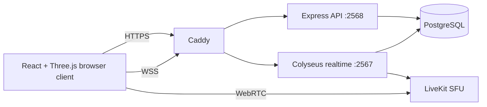
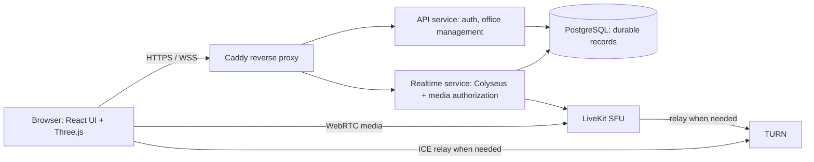

# GAMVerse project documentation

This is the single project documentation file. It combines the former `docs/`, `research/`, progress, and asset-inventory Markdown files. The first section reflects the source tree inspected on **15 October 2026**. The archived sections after it preserve earlier plans, research, and implementation notes; their paths and status claims are historical.

## Current implementation

### Product

GAMVerse is a browser-based virtual office. Users register or sign in, create or join offices, move through a shared campus, claim private workrooms, enter meeting and social spaces, and use zone- or proximity-scoped media. Office owners and admins can edit map geometry; office members can edit props and their interactions. A full top-down 2D play view is selected explicitly or at the campus zoom threshold; 3D and 2D display decisions do not change the server-owned world state.

The code is an active prototype. A production Compose profile exists, but this repository does not establish that public-host media connectivity, backup restore, security review, or the target concurrent-user load have passed.

### Runtime architecture



- `packages/client/src/ui/OfficeApp.tsx` owns the current single-page route, office controls, map/prop editing, presence and media UI. `packages/client/src/world/WorldCanvas.tsx` renders the world, avatars, and camera, and delegates the top-down view to focused `world/map2d/` modules.
- `ui/workspace/` owns office navigation, the main-menu switcher, persisted theme selection, native modal focus policy, command search and reusable person cards/actions. OfficeApp supplies current state and authoritative movement intents. Command search does not change media intent. The directory reads the existing membership-checked office endpoint and merges its member snapshot with live sessions; offline names/avatars use username/initial fallbacks because the endpoint does not expose profile fields.
- `world/map2d/map2dPresentation.ts` owns presentation-only Simplified/Immersive/Auto selection with zoom hysteresis; renderer and bitmap/frame caches share the resolved mode without changing projection or collision. `ui/media/mediaDevices.ts` owns private preview capture and device lifecycle; `mediaDevicePreferences.ts` supplies versioned device preferences to new LiveKit rooms and explicit active-room device changes. Device tests never publish, and prejoin starts the next office media session muted.
- Shared `availability.ts` separates user availability from movement and transport. `availabilityRepository.ts` stores office/user preferences through compatibility migration 025, preserving installations that applied the original availability migration as 023; `availabilityMessages.ts` serializes bounded updates, checks membership, correlates acknowledgements and expires custom status. Busy, In meeting and Away clear automatic media publishing intent and suppress social alerts without freezing movement. Client save state accepts only the current request's authoritative acknowledgement, including status expiry during storage.
- `workspace/travelFeedbackTracker.ts` owns pending route feedback and timeout notices; the server remains authoritative for route outcomes. The legacy route protocol has no request identifiers, so route replacement or timeout hides destination markers until office reset rather than attributing an old response to a newer destination. Status/cancel feedback remains usable.
- `offices/deskRepository.ts` owns canonical stable desk identities through compatibility migration 026, preserving installations that applied the original desk migration as 024. Claims, map reconciliation and member removal serialize on the office map row; saved map owner fields are projections, not authority. Moving a private zone preserves its desk ID, deleting or changing its kind retires the ID, and recreating it creates an unowned desk. `deskMessages.ts` resolves authenticated return intent against current ownership/geometry and invalidates delayed lookups on superseding movement or map/session changes. Legacy zone claim endpoints adapt to the canonical repository.
- Desk-assignment modules add map-version/owner compare-and-swap for admin assign, unassign and atomic move-to-vacant operations. Fresh session, role and target-member checks run inside the transaction. Before mutation, an internal operation-scoped fence blocks affected private entry/chat/grants and settles media revocation. Uncertain commits or failed refreshes remain fenced until matching reconciliation; no timeout silently releases access. Room creation rereads canonical map state after registration to close the creation/commit race. Ordinary desk-manager reads do not refresh unchanged maps. Recovery returns authoritative sync status, and only affected owners receive assignment notices after map application. Client `workspace/deskManager*` modules own stale-response guards and explicit reload; the office coordinator only renders the dialog and notices.
- Shared `campusFurnishing.ts` composes fresh campus generation with bounded existing-catalog furniture. Catalog dimensions and support elevations are reused; empty interiors preserve legacy output exactly. Only the new-office flow calls this wrapper and still saves map geometry and props separately. Generator, furnishing and server persistence share `officePropLimits.ts`; no saved office or editor regeneration receives automatic furniture.
- `offices/spatialConversations.ts` projects the existing authoritative zone/proximity maps into recipient-scoped conversation snapshots. Logical IDs retain deterministic proximity continuity separately from media target generations. `media/conversationGrant.ts` validates current session/office access and exact binding before and after minting. Client `media/conversationState.ts` accepts only the current transport/incarnation/revision; the existing `VoiceRoomSession` remains the sole media owner. Read-only room observers join admitted members to opaque LiveKit identities, and `meetings/MeetingWorkspace.tsx` owns camera-off tiles and view selection without reconnecting or publishing.
- `offices/publicConversations.ts` publishes public discovery without private members or transport bindings; approach resolves current geometry and membership server-side. Listen issues a fresh subscriber-only grant, while explicit Join does not restore publishing intent. Earlier Join tokens remain valid until expiry. `meetRequests.ts` and the route planner own bounded, recipient-scoped invitations, revision/expiry checks and preparation of all routes before commit. `ui/conversations/useOfficeConversations.ts` composes client snapshots, preferences and offer state; its UI hub owns presentation while the office coordinator retains travel and the sole voice-session effect.
- `offices/privateConversations.ts` and `privateZoneAccess.ts` own session-bound zone admissions, bounded knocks, expiry and moderation. Movement entry, conversation rosters and private Nearby chat consume the same authorization. `media/privateMediaEpoch.ts` rotates server-only room names and blocks new grants while revocation is pending or unavailable; grants recheck canonical access and the exact descriptor before and after minting. Old JWTs can reach an abandoned old room until expiry, but do not authorize the new epoch. A recipient-only admission lease ID lets the client mute first admission without muting an already admitted member on each epoch rotation. Camera/share remain off on room replacement. No persistence migration is part of this transient admission layer.
- `offices/meetingHands.ts` and `meetingHandCoordinator.ts` own conversation-scoped FIFO hand queues and share authorization between legacy dock and meeting commands. Pending authorization is invalidated on context changes, including leaving and returning to the same conversation. The client joins queue identities to the admitted roster. `meetings/meetingShareState.ts` owns bounded selection/zoom state; `MeetingShareStage.tsx` attaches existing screen tracks and resets zoom on share or conversation changes without owning media publication or connection lifecycle.
- `packages/server/src/entrypoints/api.ts` serves account and office HTTP endpoints. `packages/server/src/entrypoints/realtime.ts` hosts Colyseus rooms, media-token endpoints, and internal room-control endpoints. Both processes use the same server package and PostgreSQL database.
- `packages/server/src/offices/OfficeRoom.ts` owns live movement, collision, room-zone state, proximity, auto travel, seating, and vehicle interactions. Its pure grid path search and route smoothing live in `packages/server/src/offices/autoRoute.ts`; `seatApproachRoute.ts` selects available seat anchors and their approach paths. Both use shared geometry without importing the realtime room. `packages/shared/src` owns world geometry, map parsing, the prop catalog, movement helpers, and campus generation used by both sides.
- Caddy serves development HTTPS and the production web bundle. Production routes API and realtime requests to separate containers and keeps PostgreSQL on a private Compose network. A distributed presence store such as Valkey is **not** part of the current deployment.

### Browser routes and access

| Route | Purpose |
| --- | --- |
| `/` | Sign in, register, office list and office creation |
| `/office/:officeId` | Authenticated office workspace |
| `/meeting/:officeId` | Office-member meeting link |
| `/join/:token` | Accept an office invitation after sign-in |
| `/reset/:token` | One-use password reset |
| `/maintainer` | Maintainer sign-in and management |

Before joining a realtime room, the client requests the account's accessible office list and the server rechecks the authenticated session. The server enforces office-scoped owner, admin, and member permissions; active maintainers can list and enter every active office without office membership. The office creator is the owner; maintainer permission is application-wide. Realtime presence carries an `isMaintainer` flag derived from server authorization, and the client adds `(MAINTAINER)` to that user's displayed name. Browser route state and client-supplied role fields are never an access grant. In-world zone locks retain their existing authorization and movement restrictions.

Maintainers can manage platform accounts from the lobby: grant or remove maintainer access, issue one-time password reset links, suspend/reactivate accounts, review recent office/account changes in a bounded audit history, and inspect aggregate service health. Role changes are audited, revoke persisted sessions and ask realtime to disconnect the target account from active offices, cannot change the acting maintainer's own role, and cannot demote the last active maintainer. If realtime control is unavailable, the UI reports that the role changed but active connections may still need disconnecting. Suspension revokes persisted sessions and asks the realtime process to disconnect existing sessions; if realtime control is unavailable, the UI reports that the account was suspended but existing connections may still need disconnecting. The audit table retains the newest 10,000 entries and excludes reset tokens, session IDs, passwords, and request bodies. The system overview contains aggregate counts only; realtime/error metrics are process-local and are not durable monitoring.

### Persistence and map contract

PostgreSQL migrations are in `packages/server/migrations/` and applied by `initializeDatabase()` in `packages/server/src/infra/db.ts`. Current durable data includes users and hashed sessions, account suspension status, bounded maintainer audit events, office membership and invitations, password reset links, rooms/activity, character-model records, versioned office map layouts, versioned office props, and office/direct chat messages (migration `022`). Movement and presence snapshots stay in Colyseus room memory.

`RoomLayout` (`packages/shared/src/roomLayout.ts`) describes dimensions, spawn point, zones, walls, doors, roads, and props. `generateCampusMap()` (`packages/shared/src/campusMapGenerator.ts`) accepts total people, people per team, and team count; the create-office UI derives people per team from total people and team count. The ten-team design uses private 8 × 8 m workrooms, meeting spaces, a lobby, Town Hall, cafeteria, restrooms, and roads. Generated rooms have actual door leaves; legacy generated openings are converted when the layout is read. Map geometry and office props are saved through separate versioned endpoints, so map edits should not overwrite newer prop edits.

The server validates map dimensions, counts, allowlisted assets, entrances, spawn walkability, and editor role. The client displays map drafts and placement previews, but the saved server config is authoritative for collision and live rooms. The 2D renderer includes subtly textured outdoor ground, wood floors in meeting/common areas, carpet in private workspaces, tiled restrooms, labelled room zones, road curbs, and light wall caps with doorway-aware shadows. Recognized catalog furniture and foliage use shaded top-down vector details fitted to the saved prop footprints and rotation; unsupported props retain cached catalog preview icons. Floor patterns and prop details are suppressed at small scales and stay in the existing static bitmap cache. Smoothed avatars retain their head portraits, facing/status/speaking indicators and readable dark name pills above them. Its follow camera uses the same smoothed local pose as the avatar; manual pan and locate retain their selected centre. Allocation-free numeric and per-player dirty checks replace full-player frame serialization. Its static cache uses layout content and prop revision rather than the layout format version. Prop interactions survive the separate versioned props path; invalid raw interaction metadata rejects a save.

### Realtime and media

The browser sends movement intent. The server simulates movement at a fixed interval, validates paths and collision, and broadcasts player state. Office zones and proximity groups are computed from server-owned positions. Automatic travel can route to room destinations and seats; vehicles and walk fallback are handled in the realtime room.

Space triggers a short jump in 3D camera modes when gameplay has keyboard focus. The realtime room validates the request, rejects seated or driving players, rate-limits repeated jumps, and broadcasts the event. Clients animate avatar height and the first-person camera without changing server-owned ground position or collision; 2D mode has no jump.

First-person state is shared through an OfficeApp-owned ref passed into WorldCanvas alongside camera yaw. FPP input includes a validated optional facing yaw (camera yaw plus π), including stationary aim updates through the existing input send gate. The server applies aim only to on-foot, unseated orientation; movement, seat and vehicle positions remain authoritative. Rendered avatar turns use shared shortest-angle interpolation, and leaving FPP preserves the current view yaw.

Camera modes and framing transitions live in the reducer under `packages/client/src/world/camera/`. Media-zone changes within a world preserve zoom, elevation, view mode, pointer lock and pose smoothing; arrival resets are reserved for changes to the active world. Pose computation and orbit-frame position/target smoothing are pure functions. WorldCanvas wires inputs and applies the resulting pose. TPP preserves the selected distance and lens while registered wall segments, boundaries, doors, and collision props blocking the avatar fade temporarily. The occlusion module caches visual world bounds, refreshes them when roots move (including swinging door hinges), and owns isolated material copies restored/disposed on scene teardown. It fades every blocker along the sightline without traversing the scene each frame; FPP, free/edit and 2D restore normal opacity. Shared wall-span and boundary helpers still keep movement and rendering geometry consistent. Camera and connection tests are registered in the client test script.

M toggles explicit 2D/3D; V toggles TPP/FPP in 3D and is ignored in explicit 2D. In 2D, WASD remains north-up regardless of heading lock. TPP starts behind the character and follows their facing direction. While locked, W/S move along the character's facing and holding A/D changes heading by 15° immediately, then by another 15° every 200 ms, including while walking. The existing validated facing-yaw intent lets the server own and broadcast orientation. A right-button drag releases heading lock while position follow continues, restoring camera-relative movement. Focus character restores the lock. Vehicles and FPP retain their existing controls.
M toggles explicit 2D/3D; V toggles TPP/FPP in 3D and is ignored in explicit 2D. In 2D, WASD remains north-up regardless of heading lock. TPP starts behind the character and follows their facing direction. While locked, W/S move along the character's facing and holding A/D changes heading by 15° immediately, then by another 15° every 200 ms, including while walking. The existing validated facing-yaw intent lets the server own and broadcast orientation. A right-button drag releases heading lock while position follow continues, restoring camera-relative movement. The separate camera-lock action toggles heading lock; Focus character recenters and resumes following while preserving the lock setting. Vehicles and FPP retain their existing controls.

Ghost mode is hold-only on G and is suggested by a short toast when server movement detects a prop or car obstruction. It removes prop/car collision while retaining map/room walls and server-side locked-zone entry checks; players do not collide with each other. It is not exposed as a toolbar toggle.

Office connections are keyed by username and office ID. Movement intent changes and the 50 ms heartbeat share a 30 ms minimum send interval. During transport drops, movement sending pauses; the client routes close code 4002 into Colyseus 0.18's automatic session retries, then falls back to a fresh join after terminal reconnect failure. The server reserves dropped seats for 20 seconds and cancels a reserved reconnect when another session replaces it. Drop diagnostics include close codes, inbound counters and room-clock timing; simultaneous-drop causes still require runtime investigation.

LiveKit carries audio and video directly between browser and SFU. The realtime service issues short-lived, scoped media tokens only after checking live meeting, private-zone, or proximity membership. The client has microphone, camera, and screen-share controls. Statuses such as Do Not Disturb and Toilet pause interaction while presence remains online. Room entry and exit notification sounds are generated in the browser.

The office top-center voice roster shows online participants within the nearby range or in the local LiveKit voice room, with their status and published microphone, camera and screen-share state. Camera and screen-share controls focus the corresponding video in the full-screen media view. A user may adjust local playback volume or mute another participant's published track; the realtime server derives the target's current voice room from live office membership and rejects cross-zone requests. Owners, admins and maintainers can mute a media source for every active participant in that same zone. The server records moderation actions without logging media payloads.

One client voice session resolves meeting → private → proximity targets using office and realtime-session identity. It serializes room teardown, aborts obsolete authorization requests, and guards async work and SDK events against stale rooms. Unexpected fetch/connect/disconnect failures retry with fresh tokens and capped backoff; HTTP 401/403 stops recovery for that target, and retry exhaustion exposes “Reconnect voice”. SDK reconnection runs independently until a terminal disconnect. Browser freeze/pagehide and realtime transport loss suspend application recovery; resume/pageshow and realtime reconnect request spatial state and resolve the authoritative target again. Sign-out, office exit and terminal office close codes dispose the session. Initial joins are receive-only; an unmuted microphone intent survives target switches and recovery. Camera and screen sharing stop and require a new user action, with a visible notice.

Server media-zone membership retains an existing zone within a 0.5 m exit margin. Smaller zones containing the player still take precedence; removed/restroom zones cannot be retained, and movement rejects entry into locked destinations without admission. Proximity room IDs hash membership; meeting/private targets now use server-owned epochs rotated on access changes and departures. Self-hosted LiveKit does not enforce `revokeTokenTs`: an old token may reconnect to an abandoned old room until expiry. New conversation media uses a different authorized room, and a failed room-deletion transition remains unavailable rather than issuing new grants.

Office chat uses authenticated session identity and checks current sender and DM-target membership on every send. Nearby chat resolves recipients from authoritative room state and is transient. Office and DM messages persist before delivery, share a 10,000-message retention pool, and expose paged API history. DM history and cursors are restricted to the requester–target pair in one office. A bottom dock reaction button opens a keyboard-accessible emoji picker in both views, with hand raise beside it in the dock; the nearby interaction hint remains in the social overlay. Reactions are throttled transient events. Raised hands project to player schema and, within admitted conversations, a server-ordered queue shared by dock and meeting controls. Departure, offline state and conversation/admission changes clear queue membership; lowering and re-raising appends at the end.

Prop interaction validation and normalization are shared. Notes render as text. URLs require HTTPS without credentials or non-default ports; provider-specific canonical converters allow embeds for YouTube, Google Docs/Slides, Figma, Miro, and Excalidraw, with other valid destinations stored as links. All external opening shows the hostname and uses `noopener,noreferrer`.

Spotlight commands re-read office owner/admin authorization from persistence. A separate realtime `/media/spotlight-token` endpoint checks current office membership and spotlight publish eligibility before and after token minting. Spotlight media uses a separate client voice session only while someone is spotlighted. Ordinary subscriber departures revoke only their identities; recoverable drops retain spotlight membership and revoke the dropped user's identities without rotating. Session security owns pending reconnection handles and rejects them on kick, suspension, office close, disposal, or replacement. Reconnect reuses the original authenticated account token to check session validity and suspension, rechecks office membership, and then checks revocation, current username/session ownership, and player existence after the queries before restoring state. Failed access checks close with 4003. Security revocation is deduplicated until final session cleanup; closure rejects connected and dropped sessions and rotates the shared spotlight epoch once. Room disposal rejects the departing room's reserved reconnection seats. Non-last disposal removes only this room's current spotlight presenters through the security path when they have no active session in another room of the office; non-presenters do not rotate the epoch, and presenters still active in a peer room retain spotlight membership. Last-room disposal retains the office-wide security departure and epoch rotation. Room epochs also rotate on spotlight-off and a spotlighted publisher's actual leave or session replacement. Publishers who remain spotlighted retain consent across another participant's security event.

The owner accepts room-epoch isolation as the spotlight authorization boundary. Self-hosted LiveKit cannot revoke an already issued JWT in any release; no replay rejection is claimed. After epoch rotation, old-room listeners can remain until `removeParticipant` completes or reaches the named deadline. A removed publisher can rejoin the abandoned room with an unexpired token for up to `SPOTLIGHT_TOKEN_TTL_SECONDS` (60 seconds). Because ordinary subscriber departures and recoverable drops do not rotate the epoch, the same residual applies to the live current room: a departed subscriber or dropped publisher can rejoin it with an unexpired token for up to 60 seconds. Kick, suspension, office close and disposal security departures rotate immediately and reject any existing reconnection seats; close codes 4003/4004 receive no new reconnection seat. Spotlight-off and a publisher’s actual leave also rotate immediately. Future webhook admission (docs plan S1) closes this window. The deadline bounds each attempt and does not guarantee SFU removal; old-room listeners can persist if both attempts fail. Failed or timed-out removal retries once and increments the existing structured error metrics with the fixed `spotlight.revoke.retry` label; a second failure is reported. Live removal timing remains unverified. Webhook admission enforcement is deferred to a later PR.

Office navigation and people presentation live under `client/src/ui/workspace/`; the office coordinator routes their intents to existing authenticated transports. Chat presentation is separate from transport/history in `social/ChatPanelView.tsx`, with neutral message types and pure thread/composer helpers. A request revision allows repeated person actions to reopen the same DM. `world/WorldControls.tsx` owns camera-control presentation, and every map2d camera mode uses the visible 2D controls. Office panels and the media dock use scoped shell styles so account/lobby pages retain their existing layout. The broader proposed feature sequence is documented in `docs/GATHER_V2_PARITY_MASTER_PLAN.md`; these presentation changes do not add conversation lifecycle or full Meeting View.

### Assets and licenses

Deployable models, previews, textures, and pack license notices are under `packages/client/public/assets`. Larger source packs and archives are under `packages/client/assets` and are not copied wholesale by Vite. The shared prop catalog allowlists usable items; the client asset loaders resolve their URLs. The character picker includes a curated 22-model Polygonal Mind 100 Avatars subset (CC0, VRM/GLB-based) with per-model transparent PNG thumbnails rendered from each textured model, plus six KayKit Adventurers CC0 GLB presets with included sample thumbnails. Polygonal Mind and KayKit Adventurers presets use an application-provided lowered-arm idle pose and procedural walk cycle because their models contain no animation clips; the rig adapter recognizes their Mixamo and normalized KayKit bone names. The pet picker renders per-model thumbnails for the 68 Gobkit CC0 GLB pets. Keep each pack's license notice alongside any redistributed assets. No license is currently selected for the GAMVerse application source code.

### Development and deployment

- `docker compose up -d` runs the complete development stack at `https://localhost:5173` by default. Development Caddy uses a local CA certificate. Set `DEV_HOST` in an ignored `.env` file for another local hostname.
- `pnpm install --frozen-lockfile`, `pnpm build`, and `pnpm test` are the root workspace commands. The root test script covers the shared package and client connection/camera tests; the server has a separate test script. `pnpm dev` does not start PostgreSQL, LiveKit, or Caddy.
- `compose.production.yaml`, `Caddyfile`, and `.env.production.example` define a single-host Linux deployment. Configure DNS, unique secrets, HTTPS, WebRTC/TURN ports, backups, and external-network checks before use. `/health/live` and `/health/ready` are provided by API and realtime services.
- Maintainers can read a no-store `/maintainer/overview` aggregate with API/database/realtime readiness, total and suspended accounts, active offices, office-activity count over 24 hours, active realtime rooms/participants, and structured server-error count over 15 minutes. Realtime metrics cross the existing API-to-realtime internal-token boundary; the credential is never included in the response. Counts are process-local for realtime and include only the current realtime process. Error counts include only calls to the structured `logServerError` helper, are in-memory, and reset on restart; they are diagnostic signals, not durable monitoring or alerts. This view excludes user identifiers, movement, room names, raw media and payloads.
- `.env`, local certificates, dependency backups, and load-test outputs are generated/private material and should not be committed. The repository itself has no initialized Git metadata in this workspace; initialize and review the staged file list before pushing to GitHub.

### Current limitations and verification boundary

Isolated authenticated three-profile browser checks with synthetic accounts and LiveKit verified camera-off rosters, virtual camera/microphone publishing, remote decoding, availability suppression and presentation changes without reconnecting. Production-component map fixtures covered up to 100 players. P13/P14 public-conversation and invitation checks passed. P15 checks verified locked entry, scoped knocks, admission/revocation, muted re-admission, stale-grant denial and actual old-JWT isolation to an abandoned empty room. Ten-minute wall-clock expiry and forced media-admin failure have focused test coverage but were not browser-simulated. Full reference parity, real hardware and live spotlight-revocation measurements remain pending. The existing Compose HTTPS certificate path remains unverified; the isolated loopback QA stack does not establish public deployment, external media/TURN reachability, multi-host scaling, restore drills or security-audit acceptance. Historical notes below can mention earlier unimplemented plans or older file paths; use the current source and this section for the present architecture.

## Archived source documents

The following sections preserve the former Markdown files in one place. Their original paths are shown for provenance. Historical code paths and “current” status statements in these sections were written at different stages of the project and may now be outdated.

| Original path | Archived section |
| --- | --- |
| `docs/MVP.md` | [MVP and product rules](#archive-docs-mvp-md) |
| `docs/ARCHITECTURE.md` | [Architecture](#archive-docs-architecture-md) |
| `docs/CLIENT_ROUTES.md` | [Client routes](#archive-docs-client-routes-md) |
| `docs/DATA_MODEL.md` | [Data model](#archive-docs-data-model-md) |
| `docs/NETWORKING.md` | [Networking](#archive-docs-networking-md) |
| `docs/MEDIA.md` | [Media](#archive-docs-media-md) |
| `docs/ROOMS.md` | [Office rooms](#archive-docs-rooms-md) |
| `docs/SECURITY.md` | [Security threat model](#archive-docs-security-md) |
| `docs/DEPLOYMENT.md` | [Deployment](#archive-docs-deployment-md) |
| `docs/TEST_PLAN.md` | [QA test plan](#archive-docs-test-plan-md) |
| `research/RESEARCH.md` | [Technology research](#archive-research-research-md) |
| `research/BEAUTIFY_CUSTOMIZATION.md` | [Visual customization research](#archive-research-beautify-customization-md) |
| `PROJECT_PROGRESS.md` | [Project progress](#archive-project-progress-md) |
| `PROJECT_PROGRESS_UPDATE_2026-10-08.md` | [8 October 2026 progress update](#archive-project-progress-update-2026-10-08-md) |
| `packages/client/assets/kenney/README.md` | [Third-party asset inventory](#archive-packages-client-assets-kenney-readme-md) |

---

<a id="archive-docs-mvp-md"></a>

### MVP and product rules

*Preserved from `docs/MVP.md`.*


**Status:** Product scope and acceptance criteria. Current implementation status is tracked in `README.md`; full map, UI-theme and avatar customization are a planned milestone after core QA.

#### Product goal

Validate that a small team can enter the same browser based office, move around, notice one another, and talk naturally in proximity-based public space or in separate meeting/private rooms. The MVP targets one office with up to 50 concurrent users on a self-hosted stack.

#### User journey

Sign in → choose/join the office → load and spawn safely → move and see other users → go to the meeting area → opt into audio → leave it → recover from a temporary disconnect → leave/sign out.

#### User stories and acceptance criteria

| Story | Acceptance criteria |
|---|---|
| As a user, I can authenticate and join an office I am allowed to access. | Invalid or expired sessions are rejected. The server determines identity and office membership. The client displays loading, join failure and retry states. |
| As a user, I can enter an office without spawning inside a wall or another restricted area. | Spawn is selected by the server from configured safe points. A valid default spawn exists. If the office configuration has no safe point, show a recoverable error rather than silently placing the player at arbitrary client coordinates. |
| As a user, I can move and orient my avatar. | Keyboard controls work at a consistent speed across frame rates. The client sends movement intent; server simulation validates and owns the resulting position. Collision prevents crossing configured solid boundaries. |
| As a user, I can identify other people nearby. | Connected users appear as distinct avatars with display names and presence state. Remote movement is interpolated. Join/leave/stale disconnect events update the scene without duplicate avatars. |
| As a user, I can talk with office members in the meeting area or nearby. | Microphone access is opt-in and browser permission failures are explained. Server-computed meeting-zone or proximity-group membership controls audio token issuance. Mute is visible and works locally. Voice ends or is removed when users leave the relevant zone/group, office, or realtime session. |
| As a user, I can enter and leave a meeting/private room. | An office member enters through a room portal when it is unlocked. Each room has its own realtime presence and audio membership. Server-authorized transitions spawn safely and clean up the previous room. A room lock rejects new arrivals without removing current occupants. |
| As a user, I can recover after a temporary network interruption. | The UI signals connection loss, reconnect attempts and recovery/failure. The server removes stale presence after timeout. Rejoining returns to a safe, authoritative state without duplicating the user. |
| As a user, I can leave the office or sign out. | The server cleans up world presence and meeting media access. A stale client connection cannot keep the avatar or media access alive indefinitely. |
| As an office owner or admin, I can customize the office map. | An editor supports a constrained set of allowlisted floor, wall and decor pieces; placement, rotation and size are previewable in a draft. Publishing validates bounds, collision and safe spawns on the server, versions the config, and the same layout appears after reload and for other members. |
| As a user, I can customize how my character looks. | I can choose from bundled avatar presets, colors and a small set of accessories. My sanitized appearance is saved to my account and shown consistently to other office members; arbitrary uploads and external asset URLs are out of scope for the first version. |
| As an office owner or admin, I can choose the office's visual theme. | I can preview and apply a small set of coherent theme presets for surfaces, colors and typography. Text and controls retain readable contrast, visible focus and reduced-motion behavior. |

#### Controls and camera

- Desktop keyboard: **W/A/S/D** or arrow keys to move; **Shift** to walk/run only if the configured speed remains within the server movement limit; **E** to interact with a meeting zone; **Esc** to close overlays. Provide visible on-screen controls/labels so controls are discoverable.
- Use a third-person camera for the first slice, with a stable follow distance, collision-safe camera placement and a simple zoom bound. Camera input is presentation only and cannot change authoritative position.
- Avoid requiring precise mouse aim. Keep chat, presence and microphone controls usable without focusing the 3D canvas.
- Do not put essential controls behind hover-only interaction.

#### Accessibility basics

- Provide keyboard reachable controls and visible focus indicators outside the canvas.
- Pair color/status indicators with text or icons; do not communicate microphone, meeting or network status by color alone.
- Make names and important status readable at common desktop sizes, and provide an accessible DOM list of people/meeting status as a companion to 3D labels.
- Honor reduced-motion preferences for UI transitions and camera easing. Avoid flashing effects.
- Keep audio controls available to keyboard and screen-reader users. Microphone and camera activation must be explicit and show current state.
- State clearly when audio requires browser permission and offer a way to continue muted.

#### Browser and mobile behavior

- Desktop Chrome is the initial target for the first local slice. Before MVP release, the team must define a supported browser/device matrix and validate Chrome, Firefox, Safari, Windows/macOS and one mobile browser as required by the QA plan.
- The initial controls are keyboard-first. On touch devices, show an on-screen movement control and a separate interaction button; do not require a keyboard. Treat mobile as a compatibility target until its scene performance, input and audio behavior are measured.
- Use WebGL 2 as the rendering baseline. Feature-detect optional WebGPU and compressed texture capabilities, with a supported fallback path.
- On narrow screens, keep chat/presence/mic controls usable without covering the avatar's immediate movement area. Allow audio-only operation and graceful degradation when camera capture is unavailable.

#### States and edge cases

- **Empty office:** show a short invitation/help state and the local avatar; do not make the world look broken.
- **Loading:** show progress or a clear loading indicator for world assets and connection, and allow retry after failure.
- **World unavailable/full:** explain the condition and offer retry or return to office selection. The server remains the authority on capacity.
- **No microphone permission/device:** join muted and explain how to enable audio; movement and presence continue.
- **Network loss:** show a persistent reconnecting state; suppress stale remote presence after server timeout; avoid pretending the client is still authoritative.
- **Server restart:** reconnect and rejoin using authenticated identity; world configuration is reloaded from durable storage.
- **Zone boundary jitter:** use a documented entry/exit margin or short hysteresis so a user standing near an edge does not rapidly switch media membership.
- **Duplicate tabs:** define a policy (allow multiple sessions or replace the older session); enforce it on the server and reflect it in presence.
- **Invalid office configuration:** reject or fall back to a known safe default version; never let a client supply trusted geometry or permission rules.

#### MVP scope

##### Required

- One configured 3D office and one safe spawn.
- Authenticated office join with server-side membership check.
- One controllable avatar and local solid collision.
- Authoritative multiplayer movement and remote interpolation.
- Display names and connected/away/disconnected presence.
- Opt-in microphone-only meeting and proximity audio using the self-hosted SFU. Meeting members use the central walk-in zone; users outside it can join server-computed proximity groups.
- Reconnect, stale-player cleanup and logout.
- Docker Compose local environment and a documented single Linux server deployment path.

##### Customization milestone (after core QA)

- **Character, first visual slice:** Trial the bundled Kenney Mini Characters GLB in the current Three.js renderer, preserving avatar position, rotation, name labels and multiplayer behavior. Drive `idle`/`walk` clips from movement and retain the procedural avatar as a loading fallback. Review model scale, face readability and style in the actual camera; then compare other character variants or make an original mascot proof. If the look is approved, add bundled avatar presets, color palettes and accessory slots; store an allowlisted appearance profile per user and broadcast only the validated appearance DTO.
- **Map:** After the first character prototype, author a single-floor graybox with shared desks, meeting room, lounge and kitchenette/cafe. Use placeholder geometry to validate an angled top-down camera, wall cutaway/occlusion, circulation, safe spawns, collision and room portals. Once the authored layout works, add a versioned `WorldConfig` shared by rendering and authoritative movement, then a constrained grid editor for allowlisted furniture/decor and safe spawns/zones. Include draft preview, undo/redo, collision preview and publish/reload for another client.
- **UI:** Introduce CSS design tokens and a few curated office/user themes for color, surface, type scale, spacing and corner radius. Keep controls keyboard accessible and readable across themes.
- Keep map/theme settings office-scoped and appearance user-scoped. Validate config versions, dimensions, object counts and asset identifiers on the server; do not allow arbitrary scripts or remote asset URLs.
- Prioritize coherent lighting/materials, readable silhouettes and consistent visual hierarchy before adding a large catalog of content.

The character-first order is chosen because the current avatar is already a simple Three.js group and a CC0 GLB is now available for a quick renderer/animation trial without changing multiplayer movement. The first map remains a curated dollhouse-style social office inspired by the supplied reference's readable rooms and furniture, not a full Sims/inZOI-style freeform building mode. Keep the art original and use the references only for broad visual direction.

##### Optional after core loop works

- Camera/video and screen sharing (implemented as optional media controls; capture targets up to 1080p/60fps where browser/device/network permit), text chat and simple user status.

##### Later

- Full freeform 3D editor, multiple floors/worlds, user-uploaded assets, large avatar inventory, SSO, analytics, integrations, native mobile app and large-scale multi-region deployment.

#### Product success measures

- Two browser sessions join the same office, move independently, and see stable remote movement.
- The server rejects forged identity, impossible movement and unauthorized zone membership.
- Users can join/leave meeting and proximity audio without lingering media access. Microphone denial leaves movement and presence available.
- A temporary disconnect recovers without corrupting room state or leaving duplicate avatars.
- The 50-user target is measured using an agreed device/network profile and acceptable FPS, server tick delay and egress budget; numeric release thresholds are to be set before load testing.

#### Explicit non-goals

Do not clone Gather UI, branding, assets, source code or proprietary behavior. Do not build an MMO, complex economy, inventory, combat, quests, multi-floor editor or all collaboration features before validating the core office loop.

---

<a id="archive-docs-architecture-md"></a>

### Architecture

*Preserved from `docs/ARCHITECTURE.md`.*


**Status:** Initial research-backed architecture for the one-office, 50-concurrent-user MVP. Revisit choices only with evidence recorded in this document and the research report.

#### System shape



The API and realtime gateway now run as separate Node.js processes and production containers. Caddy routes account/office HTTP requests to API and matchmaking, media-token, and WebSocket traffic to realtime. The API requests room closure/member-kick operations through authenticated internal HTTP endpoints rather than importing live room state. Both services currently share PostgreSQL and the same server package/image; this is a first service split, not database-per-service isolation. In development, the two processes and Vite run together inside `office-dev` for convenience, with Caddy routing API and realtime traffic to their separate local ports. Valkey is not deployed yet; current multi-instance realtime scaling still needs shared presence and room-owner routing.

#### Components and responsibilities

| Component | Owns | Must not own |
|---|---|---|
| Browser UI (React/TypeScript) | Login/join/loading/error states, accessible controls, chat/presence panels, mic/camera affordances. | Authoritative user identity, office permissions, trusted position or zone membership. |
| Rendering (Three.js) | Scene graph, asset loading, avatar meshes/animation, camera, interpolation display. | Authentication, network authorization, canonical simulation state. |
| Client world/network adapter | Input collection, sequence numbers, WSS lifecycle, interpolation buffers, prediction only if measured necessary. | Mutating React UI state every render frame or treating local coordinates as authoritative. |
| API service | Authentication/session validation, tenant/office access, durable configuration, admin API, account and asset endpoints. | Live room state, audio/video packet handling or authoritative movement loop. |
| Realtime gateway / world room | Authenticated socket-to-user binding, office room lifecycle, movement simulation, collision/zone/proximity validation, snapshots, live membership checks for short-lived LiveKit token issuance, heartbeat and stale cleanup. | Raw media forwarding or durable user/profile data. |
| PostgreSQL | Users, tenant membership, office/world metadata, versioned map/zone config, sessions and durable audit-relevant records. | High-frequency transient avatar snapshots. |
| Valkey (planned) | Potential TTL-based presence/cache and inter-process fanout if multi-instance hosting is justified. | Durable truth or guaranteed event history. |
| LiveKit | WebRTC signaling, SFU media forwarding, media room participant/track lifecycle, optional later recording/egress. | Deciding office proximity/tenant authorization without an application-issued token. |
| TURN | Relay media connectivity when direct ICE paths fail; short-lived authenticated allocations. | User or meeting authorization. |
| Caddy | Public TLS termination and HTTP/API/WebSocket reverse proxy. | Relaying UDP media by ordinary HTTP proxy configuration. |
| Observability | Structured service logs, metrics, health/readiness, traces/correlation where practical. | Recording full chat, raw media, tokens, or unrestricted personal data. |

#### Data and trust boundaries

- User ID, tenant ID, office membership and roles come from a validated server session. Ignore identity fields claimed by browser messages.
- The API and realtime server share an authentication verification contract. A join request carries a short-lived credential or validated cookie context; realtime binds it to the socket once and rechecks expiry/revocation according to the session policy.
- Client sends intent. Realtime owns movement results, collision, presence transitions, spatial proximity and meeting-zone membership.
- API checks all requests against tenant and office membership before reading/writing configuration or issuing media access.
- World server asks the API/media token module for a narrow media grant or calls a shared authorization module; clients never see the LiveKit API secret.
- Browser connects to LiveKit directly for media. World transport and media transport are distinct and may fail/reconnect independently.
- Valkey, PostgreSQL and inter-service traffic stay on private networks. Production credentials are separate and least privilege.

#### Module boundaries

```text
client/
  ui/              # routes, accessible panels and controls
  rendering/       # Three.js scene, camera, loaders, avatar presentation
  world/           # input and client-side world presentation
  networking/      # WSS adapter, protocol, reconnect, interpolation buffer
  media/           # LiveKit client adapter and user controls

server/
  api.ts           # HTTP API process entry point
  index.ts         # Realtime/WebSocket process entry point and live voice authorization
  auth.ts          # Shared account/session domain functions
  offices.ts       # Office membership, invites and durable office operations
  world/           # deterministic movement, collision, proximity and zones
  presence/        # ephemeral presence and cleanup
  media/           # authorization and LiveKit token issuance
  persistence/     # PostgreSQL repository and migrations

shared/
  protocol/        # versioned messages and validation schemas
  types/           # stable cross-boundary DTOs
  validation/      # shared structural constraints, never a substitute for server checks
```

Simulation functions should accept explicit input/state/config and return deterministic state changes so they can be reasoned about without Three.js, React, transport or a database.

#### Initial capacity and growth

- First deployment: one Linux server, one office room, target up to 50 users. Measure CPU, memory, tick delay, client FPS, network egress and media relay ratio.
- At 500 users: add multiple realtime processes/hosts for separate office instances; shared Valkey-compatible presence/driver and explicit room-owner routing. Partition a large single office into spatial interest groups. Keep room ownership singular.
- At 5,000 users: introduce regional placement, world/instance assignment, spatial partitioning and independently scaled media. Define recovery and consistency behavior for process/host failures. These are design directions, not capacity promises.

#### Decision records

| Decision | Choice | Reason / status |
|---|---|---|
| Rendering | Three.js + TypeScript | Research recommends a small flexible 3D layer for the first office; use WebGL 2 baseline. |
| UI | React + TypeScript | Separates application UI from render loop; chosen as research-backed project direction. |
| World realtime | Node.js/TypeScript + Colyseus | Room and authoritative state support reduce custom transport/lifecycle work. Movement and authorization remain our responsibility. |
| Durable storage | PostgreSQL | Durable relational data and tenant/world ownership. |
| Ephemeral store | Valkey, pending adapter integration confirmation | BSD license and Redis compatibility; prove selected adapter/client support. |
| Media | LiveKit self-hosted | Separate SFU with token and deployment facilities. |
| Deployment | Docker Compose, Caddy, TURN | Separate API and realtime services; PostgreSQL is currently shared. Single-server operations match MVP. |
| Graphics backend | WebGL 2 | Broad baseline; evaluate optional WebGPU only after browser/device validation. |

#### Observability minimum

Expose health and readiness separately. Record connection/join/leave counts, rejected input reasons, room population, tick duration/overruns, snapshot sizes, reconnects, stale cleanups, media token denials and service dependency health. Avoid logging authentication/session tokens, complete message payloads, raw coordinates at unnecessary retention, or media contents. Use request/connection correlation IDs that do not contain secrets.

---

<a id="archive-docs-client-routes-md"></a>

### Client routes

*Preserved from `docs/CLIENT_ROUTES.md`.*


The client is a single page application. The Vite server serves the same app shell for these paths; `OfficeApp` selects the view from the current pathname.

| Path | Page or behavior | Login and access check |
| --- | --- | --- |
| `/` | Sign in, registration, or office lobby | `/auth/me` is checked before private workspace requests. An office restored from local storage must appear in the authenticated `/offices` response. |
| `/office/:officeId` | Open one office directly | The session is verified first, then the office must appear in `/offices`. Only then can `activeOffice` be set and the realtime room join effect run. Invalid or unauthorized IDs return to `/` with an error. |
| `/meeting/:officeId` | Member-only office meeting link | Uses the same session and office membership checks as `/office/:officeId`; it does not bypass office authorization. |
| `/join/:token` | Accept a one-time office invitation | Requires an authenticated session before the invitation is posted. The resulting office is opened only after it appears in `/offices`. |
| `/reset/:token` | Reset a password | Public, one-time token flow; it does not restore or join an office. |
| `/maintainer` | Maintainer sign-in and operations | `/auth/me` and maintainer login both require the maintainer role. A regular user session is logged out and shown an error. |

Route state follows `popstate` so Back and Forward restore the selected office only after access has already been verified. Session expiry clears the selected office and cached membership list before returning to sign-in. The realtime connection effect is independently gated on `authReady`, `authUser`, and `activeOffice` as a final guard against joining a room before verification.

---

<a id="archive-docs-data-model-md"></a>

### Data model

*Preserved from `docs/DATA_MODEL.md`.*


#### Storage boundaries

- PostgreSQL is the durable source of truth for identity references, tenant membership, office/world configuration, meeting zones and media configuration.
- `maintainer` is a global app-level flag. Office ownership and `admin`/`user` roles are scoped to each office, so one account can be an admin in one office and a user in another.
- Valkey stores expiring presence, cache and inter-process coordination only. Presence is reconstructible and has a TTL. Pub/Sub is at-most-once; it is not an audit log or durable event queue.
- High-frequency movement snapshots remain in realtime room memory and are not written to PostgreSQL. Persist only explicitly required durable product events.

#### Conceptual entities

##### Tenant

- `id` (UUID primary key)
- `name`
- `created_at`, `updated_at`

##### User

- `id` (UUID primary key)
- `display_name`
- `auth_subject` (unique identity provider subject or local account reference; avoid storing a raw password)
- `created_at`, `updated_at`, `disabled_at` (nullable)
- Current implementation: username, scrypt password salt/hash, global maintainer flag, activity timestamp and optional nickname are stored in `app_users`; session token hashes are stored separately in `app_sessions`. Player status is part of authenticated office state and supplies the matching color used by world name tags.

##### Office

- `id` (UUID primary key), `name`, `created_at`, `archived_at`
- `owner_username` stores one creator-owned office owner. Normal role management cannot transfer ownership. When an owner account is deleted after 30 days of inactivity, an active office assigns ownership to its oldest admin; if it has no admin, it remains with a former-owner marker.
- `app_office_memberships` holds the office-scoped `admin` and `user` roles. Owners appoint/remove admins; owners and admins manage users; maintainers can manage all offices.
- `app_office_invites` stores expiring username invitations and one-use link tokens as hashes. Accepting an invite creates the membership.
- User accounts are deleted after 30 days without activity. Offices without activity are deleted after 30 days; this cleanup also removes their memberships and invites.

##### TenantMembership

- `tenant_id` (FK)
- `user_id` (FK)
- `role` (allowlisted role enum)
- `created_at`
- Composite unique key `(tenant_id, user_id)`; all membership queries scope by tenant.

##### World

- `id` (UUID primary key)
- `tenant_id` (FK)
- `name`
- `config_version`
- `config` (validated JSONB map reference, safe spawn points, collision and zone definitions)
- `created_at`, `updated_at`
- Unique/foreign key constraints ensure world ownership remains within tenant.

##### WorldInstance

- `id` (UUID primary key or opaque room ID)
- `world_id` (FK)
- `instance_key` (unique within world)
- `capacity`
- `status` (active/maintenance/closed)
- Runtime room owner and online count are ephemeral; if persisted for operator views, treat as advisory and reconcile.

##### OfficeRoom

- `id` (UUID primary key), `office_id` (FK), `type` (`lobby`/`meeting`/`private`), `name`, optional `owner_username`, `is_locked`, `config_version`, validated `config` JSONB, timestamps.
- Exactly one lobby and at least one ownerless meeting room exist per office. A member can own at most one private room in that office.
- Door/portal links connect room configs. Runtime membership is keyed by `(office_id, room_id)` and is ephemeral; persisted lock state and room ownership are durable.
- Entry authorization requires office membership and an unlocked destination. Lock/unlock is allowed to the private-room owner from inside or outside and to a current occupant from inside.
- See [`ROOMS.md`](#archive-docs-rooms-md) for transition, lock, Spotlight and acceptance rules.

##### Zone

- `id` (UUID primary key)
- `world_id` (FK)
- `type` (meeting/proximity or future allowlisted type)
- `geometry` (validated shape and bounds)
- `config` (versioned, size-limited JSONB)
- Unique constraint on `(world_id, id)` to support scoped references.

##### Meeting

- `id` (UUID primary key)
- `zone_id` (FK)
- `access_policy` (zone, invitation or combined; finalize as product decision)
- `media_room_ref` (opaque server-side identifier)
- `created_at`, `updated_at`

##### Session

- `id` (UUID primary key)
- `user_id` (FK)
- `token_hash` (if opaque persistent sessions are used; never store bearer token plaintext)
- `created_at`, `expires_at`, `revoked_at`, device/session metadata with data minimization.

#### Ephemeral Valkey keys (proposal)

- `presence:{instanceId}:{userId}` → minimal online status, room connection ID, last heartbeat, TTL.
- `presence-index:{instanceId}` → set of active user IDs with expiry/cleanup discipline.
- `rate:{scope}:{subject}` → bounded rate-limit counters with expiry.
- Use an application namespace/prefix and tenant scoping where keys contain tenant-owned identifiers. Do not expose cache keys to clients.
- Avoid storing precise movement long term. If coordinates are needed transiently for room routing, prefer room memory and minimize cross-process copies.

#### Integrity and privacy

- Use foreign keys and tenant-scoped repository methods for durable relations. Never accept a tenant ID from a client as sufficient authorization.
- Validate JSONB config against a versioned schema before storage and before a realtime room uses it.
- Store only information required for product behavior; define retention/deletion for session and audit data.
- Do not store audio/video media in this model. Recording would require a separate consent/retention design.
- Use migrations with backward-compatible rollout and a documented rollback/restore procedure.

---

<a id="archive-docs-networking-md"></a>

### Networking

*Preserved from `docs/NETWORKING.md`.*


#### Goals

Deliver responsive office movement with server-authoritative position, safe room membership, reconnect handling and an initial limit of 50 concurrent users per office room. The current single-host Docker stack can run multiple office rooms. Use WebSocket through Colyseus for the initial protocol. Consider WebTransport only after measurements justify a second transport and browser support is defined.

#### Connection and identity

1. Browser registers or authenticates through the API. Production stores the session token hash in PostgreSQL and returns the opaque token as a Secure, HttpOnly, SameSite cookie; local development still supports the JSON file and process-memory fallback.
2. Browser requests to join an office. The WebSocket handshake sends the cookie, the server validates the session, derives the display identity from it, and checks membership in the requested office. Maintainers bypass office membership checks.
3. Realtime binds user ID and office/room membership to the connection. Ignore user IDs and tenant IDs in client-supplied state messages.
4. Server sends the canonical initial state and server-selected safe spawn. Client renders the state and begins sending input intents.
5. Disconnect starts a grace period; heartbeat timeout removes stale presence and frees the room/media membership.

#### Authority and simulation

- Server owns user identity, position, rotation, movement speed, collision, meeting-zone membership and proximity state. The media API uses that server state to authorize meeting audio.
- Client sends button/axis intent with a monotonically increasing input sequence. Do not accept client-authored target coordinates as movement authority.
- Simulate at a fixed timestep. **Initial hypothesis: 20 simulation updates per second**; measure whether 10–20 snapshots per second are sufficient for smooth interpolation. These are starting values, not guarantees.
- Clamp accepted input magnitude, elapsed time, speed and updates per connection. Reject non-finite/out-of-range values, unknown protocol versions, stale/duplicate sequences and impossible movement.
- Use deterministic movement/collision helpers in `server/world`; map collision configuration is versioned and server validated.
- Each snapshot includes server tick/time and only necessary state. Use delta/binary state sync where Colyseus provides it; do not send media or durable profile data in movement snapshots.

#### Provisional protocol events

| Direction | Event | Payload intent |
|---|---|---|
| Client → server | `office.join` | Office key and optional reconnect token; identity comes from session. |
| Server → client | `office.state` | World/config version, local server-selected spawn and current authorized player state. |
| Client → server | `player.input` | Protocol version, sequence, normalized movement axes/buttons. |
| Server → clients | `world.snapshot` | Server tick and authoritative visible player states. |
| Server → client | `presence.update` | Display name, status and join/leave changes visible in this room. |
| Client → server | `presence.request` | Request a resync after reconnect; no identity/position mutation. |
| Server → client | `zone.update` | Server-derived zone and media authorization transition. |
| Either direction | `connection.error` | Stable error code and retryability; never include stack traces/secrets. |

Exact schemas, maximum payloads and protocol version policy are implementation contracts and belong in `shared/protocol`. Use runtime validation on all client input even when TypeScript types exist.

#### Interpolation and prediction

- Keep a short timestamped buffer of remote snapshots and render remote avatars slightly behind server time to interpolate between known samples.
- Extrapolate only briefly and clamp it; return to authoritative snapshots when new data arrives.
- Render the local avatar immediately from local input for responsiveness, then reconcile toward server state. If visible correction is too large, first check tick and network measurements; add prediction/replay only if the simpler approach fails.
- React UI subscribes to coarse presence/network state; the render loop reads a dedicated world state/interpolation model rather than triggering a React render for every frame.

#### Rooms, interest and proximity

- Initial room maps to one office instance and has a configured maximum population.
- Server maintains spatial cells or a broadphase index as needed. Initially, a full room snapshot may be acceptable at 50 users; profile bandwidth and CPU before assuming so.
- At higher density, only send state for nearby/visible participants and use cell subscriptions with overlap at boundaries to avoid pop-in.
- Proximity and zone membership are computed on the server from validated position and server-owned world configuration. Add entry/exit hysteresis to avoid boundary flicker.
- A world room owns its simulation process. Scaling distributes distinct rooms; one hot room needs an explicit sharding/interest strategy rather than merely more replicas.

#### Reconnect and heartbeat

- Client uses bounded exponential backoff with jitter and visible connection state. Stop retries on explicit auth denial or user logout.
- Rejoin revalidates session and office permission. Restore from authoritative durable configuration and current online state; do not trust a client-submitted position to restore authority.
- Heartbeat and server-side idle timeout detect half-open connections. Remove user from world and media after a documented grace interval.
- If realtime, Valkey or PostgreSQL restarts, application retry/readiness behavior must be explicit. A Valkey outage may isolate process-local presence; do not fabricate a durable guarantee from Pub/Sub.

##### Current implementation behavior

- The API supports username/password registration and sign-in. Usernames are normalized to lowercase and must be 3–24 letters/numbers/dot/dash/underscore; passwords must be 8–128 characters. Production stores salted scrypt hashes and hashed session tokens in PostgreSQL. Local development uses the ignored JSON file and process-memory sessions. Sessions expire after 7 days.
- `lastActiveAt` is updated on registration/sign-in and while an authenticated office connection is active (including an idle avatar in the room). Accounts with no sign-in or active office connection for more than 30 days are hard-deleted at startup and by an hourly cleanup job; PostgreSQL cascades their sessions. Legacy local records without `lastActiveAt` use `createdAt` as the cleanup baseline.
- The office room requires a valid cookie-backed session and office membership, and takes the display name from the authenticated server identity. Account registration is open. Office membership can come from a username invitation or a one-use invite link; roles are enforced by the server.
- Colyseus client transport retries up to 6 times with bounded exponential delay (250 ms base, 3 s cap). The server marks the player as `away`, stops accepting movement for that session, and reserves the session for up to 20 seconds.
- A successful transport reconnect keeps the same player entry and returns its presence to `online`. If transport retries finish without recovery, the client attempts a fresh office join and retries that join up to 5 more times with bounded exponential delay; a restarted server therefore creates a new guest session in its current in-memory room when it becomes available.
- After the 20-second grace expires, the old player entry is removed. Room state remains in process memory; reconnect behavior still needs multi-client interruption tests before release.
- The client labels another online player as `Nearby` within the shared 4.5 m radius. The server currently computes proximity membership for presence/UI; proximity voice remains pending. Meeting-zone media authorization is enforced separately from the server-computed zone state.

#### Rate limits and validation

- Enforce message-size and event allowlists at the transport boundary.
- Limit joins, input events, resync, chat and media-token requests per user and per connection/IP where appropriate.
- Validate numeric bounds, timestamps, sequence age, office/zone identifiers, session expiry and authorization on the server.
- Rate-limit violations should be observable without logging full sensitive payloads.
- Realtime input processing must use bounded queues and discard obsolete movement intent if an overload policy permits; never allow unbounded buffering.

#### Scaling path

- **50 concurrent:** one process/room and a measured snapshot cadence.
- **500:** several room processes/hosts; shared presence/driver; load balancer or room-owner routing; spatial interest filtering for crowded rooms.
- **5,000:** multiple regions and room assignment; shard large offices; define failover and presence consistency; measure network fanout independently from server simulation.

Estimate bandwidth from measured serialized snapshot size × actual recipients × cadence, including protocol overhead and reconnect bursts. No capacity claim is finalized until profile and load-test inputs are fixed.

---

<a id="archive-docs-media-md"></a>

### Media

*Preserved from `docs/MEDIA.md`.*


#### Choice and boundary

Use self-hosted LiveKit as the WebRTC SFU. Public proximity audio and the current walk-in meeting/private areas are implemented locally; external TURN/firewall validation remains pending. The browser connects to the SFU directly for media. The API/world server never receives or processes raw audio/video packets. World simulation owns proximity and room membership decisions; LiveKit owns media signaling and forwarding. The target room model and rollout are in [`ROOMS.md`](#archive-docs-rooms-md).

#### Proximity voice

Proximity audio uses server-computed connected groups and is opt-in. Groups are formed from nearby-player links using the configured distance and 0.5 m exit hysteresis. Connected components mean A can hear C through B when A-B and B-C are nearby even if A-C are farther apart. Users in the central meeting zone use the meeting room instead, so the two voice modes do not duplicate audio.

- Meeting and proximity audio use room-scoped LiveKit tokens minted by the backend after checking the authenticated session and exact realtime session's server-tracked zone or group. Meeting tokens expire after five minutes; proximity tokens expire after one minute. Active participants are removed and their tokens revoked when a group changes; an unused proximity token can remain valid for at most its one-minute lifetime. Both permit microphone publication only; API secrets never reach the browser.
- The world server computes proximity groups from authoritative positions and sends updates only when a user's group changes. Entry uses `WORLD.proximityRadius`; exit adds 0.5 m hysteresis. Proximity group IDs are derived server-side; the client cannot choose a room.
- A group change revokes existing participants in the previous LiveKit room; the client reconnects only if the user previously opted in.
- If spatial attenuation/panning is implemented, it is a client presentation effect; server-side subscription/membership remains the access-control boundary.
- In the separated-room model, every room receives an independent LiveKit namespace derived from `(office_id, room_id)`. Public lobby proximity groups remain separate. Spotlight grants are issued only to authenticated participants in that exact room and broadcast within that room only.
- Define whether distant users are unsubscribed, muted by server policy or separated into proximity subrooms. Validate LiveKit participant/track limits and behavior for the chosen design.

#### Walk-in meeting zone

- Zone geometry and meeting ID come from trusted world configuration. The central rug at `(0, 0)` is the walk-in meeting area, with 2.15 m entry radius and 0.3 m exit hysteresis. Any signed-in office member may enter by position; this is not invite-only private access. The office meeting link is navigation only and auto-walks a member to the rug.
- The world server evaluates zone entry and exit from authoritative positions, keeps an exact session membership record, and emits entry/exit changes. On exit, disconnect, or office leave, it removes the participant from the LiveKit room and revokes the token.
- API issues room-scoped LiveKit permission only after server authorization. Token includes only necessary identity, room and publish/subscribe grants, with a short expiration.
- Leaving the zone or losing office membership revokes/updates media permissions and removes the participant from the meeting media room. Reconnect repeats authorization.
- Guessing a meeting room name or sending a client zone event grants no access.

#### User controls and media behavior

- Audio is opt-in. The user must click “Join meeting voice”; the app then requests microphone permission and starts muted until LiveKit enables the microphone as part of that explicit action.
- The meeting voice control can mute/unmute the microphone or leave the room. Deafen is not implemented yet.
- Camera and screen share are later optional features. Each requires an explicit user gesture, browser permission, visible active-state indicator and a clear stop action.
- Microphone unavailable/denied must not prevent movement or presence. Show reconnect and device error states.
- Define whether audio continues while a browser tab is backgrounded and respect browser autoplay/user-gesture behavior.
- Do not record by default. If recording is later added, define consent, retention, access, deletion and regional legal requirements first.

#### TURN and networking

- Configure TURN for clients whose ICE checks cannot establish a viable direct path to the SFU. TURN is a relay fallback and increases bandwidth/latency; measure how often it is used.
- Support the required UDP path and document TCP/TLS fallback only if the chosen LiveKit/TURN configuration supports it and firewall testing confirms it.
- Publish only required signaling, media and relay ports. Set public IP/port mappings correctly behind NAT and confirm symmetric NAT/corporate network cases.
- Use short-lived TURN credentials generated with a server-held secret. Never ship the shared TURN secret in browser code or source control.
- Test direct and relayed calls from separate networks, including restrictive NAT/firewall conditions.

#### Security and operations

- API authenticates user and office access before minting media token. Tokens are signed with server-only credentials and minimal grants.
- Room name is not a secret and is not an authorization mechanism.
- Validate server-side room membership transitions. Keep API secret and TURN shared secret out of images, logs and browser bundles.
- Monitor room/participant/track counts, connection failures, ICE/TURN relay ratio, packet loss, jitter, bitrate and egress. Do not log media contents.
- Pin LiveKit image/version and document upgrades. Test server restart and client reconnect behavior.

#### Rollout

1. Validate meeting-zone and proximity audio between two browser sessions.
2. Validate group transitions, meeting-zone changes, office leave, token revocation and microphone denial.
4. Test TURN relay and self-host networking from an external network.
5. Only then consider camera and screen sharing.

---

<a id="archive-docs-rooms-md"></a>

### Office rooms

*Preserved from `docs/ROOMS.md`.*


#### Product rules

- An office contains a shared lobby and independent room instances. Meeting and private rooms are real rooms with separate realtime presence and audio; they are not voice circles painted on the lobby floor.
- Members move between rooms through a door/portal. The server validates the destination and office membership before moving a session. A room transition removes the player and media access from the source before they are admitted to the destination.
- Every office has a shared lobby and at least one ownerless meeting room. Each office member may own at most one private room. A private room remains associated with its owner; office admins can manage its placement and settings.
- Any office member may enter an unlocked room. A locked room rejects new entrants while existing occupants remain connected.
- The room owner or a member currently inside the room may lock or unlock it. A room owner may unlock their room while outside. Office admins/maintainers can manage room configuration, but do not bypass a room lock for ordinary entry.
- Spotlight is scoped to the current room instance. It reaches every participant in that room regardless of avatar distance; it never broadcasts to another room or the whole office by accident.
- Public lobby voice remains proximity-based. Private and meeting rooms connect their occupants without distance attenuation.

#### Runtime and persistence contract

- Durable room metadata belongs to PostgreSQL and is scoped by `office_id`: opaque room ID, type (`lobby`, `meeting`, `private`), name, optional owner, lock state, door/spawn coordinates and a versioned, validated world configuration.
- Colyseus room identity is the tuple `(office_id, room_id)`. Client-supplied IDs select a destination but grant no access; the realtime server checks office membership, room existence, lock state and transition eligibility.
- LiveKit room identity is derived by the server from the same tuple. Tokens are short lived and include only the publish/subscribe rights needed by the current room mode. Spotlight grants are room-scoped.
- A lock state change is server-authoritative and broadcast to occupants. It prevents future joins; it does not disconnect people already inside.
- Room transitions preserve the authenticated account and office role, assign a safe spawn in the destination, clean up the previous room's media memberships, and provide a return portal.

#### Delivery sequence

1. **Done:** Add durable room metadata, seed a lobby and shared meeting room for each existing office, and expose authenticated room APIs.
2. **Done:** Scope realtime joins and media authorization to `(office_id, room_id)`, enforce lock rules and validate door transitions server-side.
3. **Done:** Show room doors and lock state in the scene, provide a return door, auto-walk/keyboard entry and room lock controls. The owner can lock from outside; a current occupant can lock from inside.
4. **Implemented; live multi-client verification pending:** Public lobby uses proximity groups; all participants in the same meeting/private room share its audio without distance attenuation. Room media tokens are room-scoped.
5. **Next:** Connect room configuration to an admin map editor so doors, spawn points, bounds and decor can be customized and published safely.

##### Current checkpoint

- PostgreSQL migration `005_office_rooms.sql` is applied by the Docker dev server.
- Docker `pnpm build` passed for shared, server and client. Vite reports a large-chunk advisory for LiveKit and the main app bundle.
- Local services are running through Compose. This verifies startup and type/build integration, not the multi-browser enter/lock/media acceptance scenarios.
- Keep derived room portal rendering after all React state declarations: `roomPortals` depends on `activeRoomKey` and `officeRooms`; declaring it before those `useState` calls causes a temporal-dead-zone runtime error and a blank page.
- Room creation currently chooses door positions automatically; admins cannot yet drag doors or edit room geometry. Private-room owner deletion and other account cleanup rules still need to be wired to a room-retention policy.

#### Acceptance

- Two sessions in the lobby can discover and enter an unlocked meeting/private room; room presence and audio are isolated from the lobby and every other room.
- A non-member cannot enter any room. An office member cannot enter a locked room, even by guessing its ID or calling the API directly.
- The room owner can lock/unlock from inside or outside. A current occupant can lock/unlock from inside. Locking leaves current occupants in place and rejects later arrivals.
- A door transition leaves the previous Colyseus and LiveKit room, then spawns safely in the destination. Return portals work after refresh/reconnect and do not grant office access. **Still needs two-session browser QA.**
- Spotlight reaches all members in the current room regardless of distance and no one in another room receives the stream.
- Deleting/removing a member revokes room access. Deleting an office cascades its rooms; deleting an owner account removes their private room or follows the documented owner cleanup policy. **Account cleanup integration is pending.**

---

<a id="archive-docs-security-md"></a>

### Security threat model

*Preserved from `docs/SECURITY.md`.*


**Scope:** MVP browser client, API, authoritative world server, PostgreSQL, Valkey, LiveKit and TURN. This document defines implementation controls and verification steps; it is not a claim that the product has passed a security audit.

#### Assets and trust boundaries

##### Assets

- User identity, session and tenant membership.
- World configuration, safe spawns, collision bounds and private meeting policy.
- Authoritative position/presence and access to proximity/meeting media rooms.
- LiveKit signing key, TURN shared secret, database/cache credentials and deployment secrets.
- Profile/chat data and operational logs/metrics.

##### Trust boundaries

- Browser to API over HTTPS.
- Browser to realtime server over WSS.
- Browser to LiveKit/TURN over WebRTC/ICE.
- API/realtime services to PostgreSQL and Valkey over private service networks.
- Operator to Linux host, container registry and backup storage.

Assume every browser field, client coordinate, user/tenant/room identifier, chat string and reconnect claim can be forged. TLS protects transport but does not make a client trustworthy or authorize an action.

**Implementation status:** a single-host production path stores users, office memberships, invitations and hashed, expiring/revocable sessions in PostgreSQL, issues HttpOnly/SameSite cookies, checks the auth origin, and protects office room joins. Maintainer, owner, admin and user permissions are checked on the server. The production Compose profile terminates TLS at Caddy and keeps PostgreSQL private. This has not passed a security audit or production host validation. Registration is open. Login throttling and monitoring are still missing. Realtime proximity groups and meeting-zone membership are computed from server-owned positions; client messages cannot grant media access. Meeting links do not grant office access. Proximity audio is opt-in and uses server-issued group-scoped tokens; live participants are removed when groups change, while unused tokens expire within one minute. Account recovery allows a user to change their password after confirming the current password, or a maintainer to issue a one-use, 15-minute reset link. Tokens are stored as hashes; issuing a new link revokes the previous pending link. Password changes and resets revoke persisted sessions, but already connected realtime sockets are not actively revoked until their next authorization check. Do not reuse passwords from other accounts.

#### Findings and controls

| ID / Severity | Attack scenario | Impact | Mitigation | Verification |
|---|---|---|---|---|
| SEC-01 **High** — identity/position spoofing | Client changes a user ID, tenant ID, target position, speed, zone ID or snapshot sequence to impersonate a user, teleport through walls or force private-room proximity. | Avatar impersonation, restricted-area traversal, false presence, meeting access and potential denial of service. | Bind identity to authenticated server session. Accept movement intent only. Validate finite numeric values, axes, input rate/sequence, speed and elapsed simulation time. Compute collision/proximity/zone membership on server. | Submit forged IDs, extreme/NaN/infinite values, teleports, high speed, duplicate/stale sequences and fake zone events. Confirm rejection and no state/media membership change. |
| SEC-02 **High** — WebSocket cross-site hijacking | A malicious site opens an authenticated socket using victim cookies if handshake Origin is not checked. A valid socket is then used for actions the victim can perform. | Unauthorized actions, movement/presence abuse and private meeting access as the victim. | Require HTTPS/WSS; allowlist exact origins on every handshake; authenticate before joining; check authorization for each message; expire/revoke sessions and close stale sockets. Add CSRF proof if cookie-auth handshake design requires it. | Attempt hostile and absent Origin; test expired/revoked session, unauthorized actions, user logout and long-lived connection behavior. |
| SEC-03 **High** — meeting-zone authorization bypass | Attacker guesses a room name or submits a meeting ID/zone transition directly, then requests a LiveKit token. | Joining meeting audio while outside the server-validated zone. | Check office access and the exact session’s server-computed zone status before issuing tokens. Meeting links only navigate; they do not grant office access. Treat room names as non-secret. Issue microphone-only room-scoped grants with short TTLs and remove/revoke participants when they leave. | Attempt another office ID, guessed room names, direct token endpoint calls, token requests from outside the zone, video publish escalation, and leave/rejoin after exiting. |
| SEC-04 **High** — SFU token leakage/escalation | Long-lived token or server secret is exposed in browser bundle, logs, URL, source or error output; token grants broad room access. | Persistent unauthorized media participation or access to unrelated rooms/recordings. | Keep signing key server-side. Mint short-lived, least-privilege tokens after authenticated authorization. Do not place tokens in query strings/logs; restrict publish/subscribe/record grants. Rotate secrets and image versions. | Inspect built client, logs and URLs for secrets. Reuse expired/wrong-room token and attempt publish/subscribe/record permission escalation. |
| SEC-05 **High** — TURN open relay or secret compromise | Unauthenticated/open TURN allocation is used to relay third-party traffic or exhaust egress; shared TURN secret shipped to browser. | Bandwidth cost, service outage, IP reputation or third-party abuse. | Use time-limited credentials generated by server-held secret. Apply allocation/user quotas, allowed relay ranges, firewall restrictions and monitoring. Rotate key. | Attempt allocations with missing, forged and expired credentials; verify public port exposure, quotas and relay-only client connectivity. |
| SEC-06 **High** — tenant isolation failure | API/realtime accepts client-supplied tenant/world IDs without verifying membership, or a database query omits tenant scope. | Cross-tenant profile/config/meeting disclosure or modification. | Derive tenant from session/membership. Scope each repository operation by authorized tenant and resource. Deny by default; enforce foreign keys/unique constraints and avoid ID-only lookups for tenant resources. | Use a second tenant's user/world/zone IDs on every API and realtime operation. Confirm denial and no data leakage through errors. |
| SEC-07 **Medium** — packet flood/resource exhaustion | Client floods join/input/resync/chat messages or sends huge/deep payloads; dead sockets remain allocated. | CPU/memory exhaustion, tick overruns, broadcast amplification and degraded office availability. | Maximum payload/depth, strict schemas and event allowlist; per-user/connection/IP limits; join throttling; bounded queues; ping/pong heartbeat, idle timeout and overload policy. Do not log full malicious payloads. | Load with oversized, malformed and burst traffic; confirm bounded memory/queues, rejection, stale cleanup and useful metrics. |
| SEC-08 **Medium** — XSS through display name, chat or world metadata | A stored string is inserted into HTML/DOM unsafely or loaded as rich content. | Script execution in other users' authenticated browser sessions; theft/use of in-page tokens and actions. | Render untrusted values as text with framework escaping. Avoid unsafe HTML sinks. If rich text is introduced, use a reviewed sanitizer and strict allowlist. Add a tailored CSP as defense in depth. | Store script/event-handler/URL payloads in all user-visible fields and verify text-only rendering, no execution and CSP behavior. |
| SEC-09 **Medium** — session fixation/theft/CSRF | Session identifier is not rotated after login, cookie is readable/insecure, session outlives logout, or cross-site request uses ambient credentials. | Account takeover or unauthorized account/admin changes. | HTTPS/HSTS; Secure, HttpOnly, SameSite cookies and host-only scope where cookies are used; regenerate session on authentication; server-side expiry/revocation; CSRF tokens/origin checks for state-changing requests. Never put session IDs in URLs. | Inspect cookie attributes; test pre/post-login session rotation, logout invalidation, expiration, CSRF and cross-origin requests. |
| SEC-10 **Medium** — internal service/cache exposure | PostgreSQL/Valkey or adapter pub/sub is exposed to the public internet or untrusted workloads can write channels. | Credential theft, state disclosure, forged internal messages, database compromise. | Private network and firewall; distinct credentials/ACLs; TLS where network boundary warrants it; least privilege; no shared cache tenancy without channel ACL/isolation. Keep internal admin/metrics protected. | Port scan host, connect from outside, attempt unauthorized database/cache commands and pub/sub injection. |
| SEC-11 **Medium** — dependency/container supply chain | Vulnerable/unmaintained dependency, compromised package/image, or stale native SFU/decoder is deployed. | Remote code execution, data leak or service compromise. | Lock dependency graph; pin container versions/digests; review advisories and license changes; generate/retain SBOM; rebuild/update with rollback plan; restrict runtime privileges and writable mounts. | Run package and image vulnerability scans in delivery pipeline; inspect transitive/native dependencies and verify upgrade/rollback. |
| SEC-12 **Low–Medium** — privacy leakage in logs/presence | Logs persist tokens, complete messages, exact movement or IP/device metadata beyond operational need. | Account compromise, sensitive movement/availability disclosure, retention/compliance exposure. | Minimize fields and retention; never log bearer/media/TURN secrets or complete payloads; restrict log access; document retention and deletion. Keep raw media out of logs/storage. | Search test logs and stored presence for secrets/overly precise data; verify retention cleanup and operator access controls. |
| SEC-13 **Medium** — unsafe world/admin configuration | Admin or imported map config contains huge geometry, invalid spawn/collision/zone bounds, scriptable asset URL or cross-tenant references. | Room crash, unsafe spawn, bypassed collision/meeting policy or server-side fetch risk. | Role-check admin endpoints, validate versioned schema and size/count limits, allowlist asset hosts/types, prevent arbitrary URL fetches, validate tenant/world relations and publish config atomically. | Submit malformed/oversized/cross-tenant config, unsafe URLs and zone/spawn edge cases. Confirm rejection and previous valid config remains active. |

#### Minimum implementation rules

1. Authenticate at the API and realtime boundaries; derive identity from a validated session, never a browser ID.
2. Authorize each tenant, office, meeting and admin action on the server. A valid socket or media token is not permission to every action.
3. Parse messages with bounded schemas; reject unknown versions/fields where appropriate and cap payload size, rates and queues.
4. Keep browser, API, world server, media and persistence responsibilities distinct. Raw media does not pass through the simulation server.
5. Protect secrets in deployment configuration, rotate them and redact logs. Never commit real environment values.
6. Use TLS/WSS in deployed environments; protect cookies and state-changing HTTP calls against session/CSRF attacks.
7. Keep PostgreSQL and Valkey off public interfaces. Treat internal service networks as trusted infrastructure that still needs least privilege.
8. Inventory exact versions and licenses, including images, transitive packages, codecs/native libraries, fonts, avatar models, textures and sounds.
9. Minimize presence retention and avoid default recording. Define explicit consent and deletion if recording is added later.

#### Security test plan by milestone

- **First vertical slice:** spoofed user ID, malformed input, impossible movement, replayed sequence, origin rejection, oversized message and stale socket cleanup.
- **Proximity/meeting:** cross-tenant access, guessed room ID, zone spoof, early token request, token expiry/reuse and leave-zone cleanup.
- **Auth/persistence:** session rotation/revocation, CSRF, tenant-scoped CRUD, XSS strings, role enforcement and migration/config validation.
- **Deployment:** external port scan, secret scan of source/image/client bundle/logs, DB/cache inaccessible from public network, TURN auth/quota and restore/rollback.

#### Sources

- [OWASP WebSocket Security Cheat Sheet](https://cheatsheetseries.owasp.org/cheatsheets/WebSocket_Security_Cheat_Sheet.html)
- [OWASP Session Management Cheat Sheet](https://cheatsheetseries.owasp.org/cheatsheets/Session_Management_Cheat_Sheet.html)
- [OWASP CSRF Prevention Cheat Sheet](https://cheatsheetseries.owasp.org/cheatsheets/Cross-Site_Request_Forgery_Prevention_Cheat_Sheet.html)
- [OWASP XSS Prevention Cheat Sheet](https://cheatsheetseries.owasp.org/cheatsheets/Cross_Site_Scripting_Prevention_Cheat_Sheet.html)
- [LiveKit security and token permissions](https://livekit.com/security)
- [LiveKit self-hosting and firewall deployment guidance](https://docs.livekit.io/transport/self-hosting/)
- [Socket.IO Redis adapter security considerations](https://socket.io/docs/v4/redis-adapter)
- [MDN WebSocket API](https://developer.mozilla.org/en-US/docs/Web/API/WebSockets_API)
- [MDN WebTransport API](https://developer.mozilla.org/en-US/docs/Web/API/WebTransport_API)
- [Redis Pub/Sub delivery semantics](https://redis.io/docs/latest/develop/use-cases/pub-sub/)

---

<a id="archive-docs-deployment-md"></a>

### Deployment

*Preserved from `docs/DEPLOYMENT.md`.*


#### Development

The MVP should run on a developer workstation with Docker Compose. Expected services:

- Caddy reverse proxy / local HTTPS configuration
- Web client, HTTP API service, and realtime/WebSocket service
- PostgreSQL
- Valkey
- LiveKit SFU
- TURN server (coturn or the TURN component supported by the selected LiveKit deployment)

Compose services should have health checks. Use `depends_on: condition: service_healthy` for readiness where useful, while application code still retries dependencies after startup. Bind database/cache ports only when local debugging requires it.

In production, Caddy serves the built web client and routes account/office HTTP endpoints to `api`, while matchmaking, media-token endpoints, and WebSocket upgrades go to `realtime`. These are separate application containers built from the same server image. They currently share PostgreSQL; the API uses an internal token to request room kicks and closures from realtime. Do not expose the internal routes or token publicly.

#### Single Linux server production profile

##### Prerequisites

- A public DNS name pointing to the server and control of ports required for HTTPS and WebRTC.
- A Linux host with Docker Engine and Compose plugin, adequate disk for PostgreSQL backups/logs, and a stable public IP or documented NAT mapping.
- A supported TLS certificate path. Caddy can automate certificates when DNS and public reachability prerequisites are met.
- Explicitly chosen hardware/network profile based on the 50-user load shape; no fixed sizing is supported by the current evidence.

##### Network and DNS

- Publicly expose TCP 80/443 for HTTPS and redirects. Point both `DOMAIN` and `LIVEKIT_DOMAIN` DNS records to the host; Caddy terminates TLS for the web app and LiveKit signaling.
- The current LiveKit Compose profile exposes TCP 7881, UDP 7882, UDP 3478, and UDP relay ports 30000–30500; expose TCP 80/443 for signaling via Caddy. These defaults are pinned in `compose.production.yaml` and must be open in the host/cloud firewall.
- Route browser/API/WSS and LiveKit signaling through Caddy. WebRTC UDP and TURN relay traffic use the published LiveKit ports directly; an HTTP reverse proxy does not carry that traffic.
- Keep PostgreSQL and Valkey bound to the private Compose network. Protect internal admin/metrics endpoints.
- Document firewall rules and test from an external network; local calls may succeed without proving public ICE reachability.

##### Secrets and configuration

- Keep secrets out of Git, frontend bundles, command history and container image layers.
- Use separate credentials for PostgreSQL, Valkey, LiveKit token signing and TURN authentication.
- Use least-privilege database roles and Valkey ACLs. Rotate credentials using a documented procedure.
- Commit safe defaults in an example environment file; deploy real values through a protected environment/secret mechanism.
- Pin container image versions/digests and record upgrade notes. Avoid floating `latest` tags in production.

##### Data and backups

- Persist PostgreSQL data on a durable volume and back it up off-host.
- Define recovery point/recovery time targets before production. Test database restore on a separate location at a documented interval.
- World map/config assets need versioned backups and a clear mapping from database config version to asset bundle.
- Valkey presence can be rebuilt; persist it only if a specific operational need is documented.

##### Logs, metrics and health

- Provide health/readiness endpoints for API/realtime; monitor PostgreSQL, Valkey, LiveKit and TURN reachability.
- Collect CPU, memory, disk, server tick duration/overruns, connected users, WSS reconnects, room fanout, SFU participants/tracks, TURN allocations, packet loss/jitter and network egress.
- Rotate logs and avoid recording tokens, full messages, or raw media. Limit access and retention.
- Alert on backup failure, low disk, repeated service restarts, sustained tick overruns, excessive relay egress and certificate renewal failure.

##### Upgrade and rollback

1. Back up PostgreSQL and configuration before a release.
2. Build/pull pinned images and inspect dependency/license/security changes.
3. Apply compatible migrations, then roll out application containers.
4. Check health, login, join, movement, audio, meeting authorization and reconnect flows.
5. If unhealthy, restore the previous image set and use the documented migration rollback or database restore plan. Never assume an irreversible schema migration can be rolled back by restarting containers.

#### Kubernetes and managed infrastructure

Kubernetes is deferred until multiple hosts, workload scaling, service availability or operations justify cluster management. If adopted, plan persistent storage, load balancing, room-owner routing, UDP media, TURN, secrets, RBAC, node upgrades and disaster recovery. Managed database/SFU services can be an optional profile but change cost, residency, dependency and data-control assumptions; document the specific service terms.

#### Deployment acceptance checklist

- A new operator can configure DNS and secrets from documented examples without committing credentials.
- Compose startup waits for readiness where applicable and dependent services reconnect after restart.
- HTTPS, WSS, SFU signaling, UDP media and TURN fallback work from a separate external network.
- Database backup restore and application rollback have been exercised before public launch.
- Firewall exposes no PostgreSQL, Valkey or internal-only admin endpoints publicly.
- Logs/metrics do not expose session tokens, media tokens, TURN shared secrets or unnecessary personal data.

---

<a id="archive-docs-test-plan-md"></a>

### QA test plan

*Preserved from `docs/TEST_PLAN.md`.*


This plan follows `agents/qa-agent.md` and `PROMPT.md`. A feature is not complete based only on a happy-path demo. Record environment, browser/device, build revision, steps, expected result, actual result and any logs for each run.

#### Functional acceptance

##### Core office flow

- Sign in, select an office and join only when the account is a member.
- Load the world and spawn at a valid server-selected location.
- Move with WASD/arrows; verify camera-relative movement, bounds and wall/desk collision.
- Open two browser sessions as different users. Verify independent movement, names, presence and smooth remote interpolation without duplicate avatars.
- Leave the office and sign out; verify presence and media access are cleaned up.

##### Voice and media

- With two sessions in public space, verify automatic proximity grouping, entry/exit hysteresis and audible distance fade. Verify users outside the authorized group do not receive audio.
- Enter and leave private and meeting zones. Verify only authorized zone members join that audio room and membership changes revoke old room access.
- Deny microphone permission and confirm movement/presence remain usable with a clear error.
- Verify mute state, camera, screen share, stop controls, full-screen focus selection and mini-screen scrolling. Treat 1080p/60fps as a capture target; record actual negotiated resolution/frame rate and network conditions per device.
- Test reconnect, office leave and server restart; ensure tracks stop and stale participants are removed.

#### Realtime and failure cases

- Introduce latency, packet loss and a short network interruption; verify authoritative state recovers without impossible position jumps or duplicate players.
- Restart the world server and media server separately; verify clients recover or show a clear retry state.
- Submit duplicate/delayed movement messages and malformed payloads; verify the server ignores or rejects them safely.

#### Browser and accessibility matrix

- Smoke test current Chrome on Windows first; then Firefox, Safari, macOS and one mobile browser before release.
- Verify keyboard navigation, visible focus, reduced-motion preference, readable status labels and responsive controls.
- Check scene frame rate and layout at desktop and narrow/mobile viewports.

#### Security checks

- Attempt spoofed user/session IDs, unauthorized office/zone access and impossible coordinates.
- Verify private map drafts and publish actions require owner/admin/maintainer authorization.
- Verify world config rejects unsupported versions, out-of-bounds geometry, excessive object counts, invalid spawn points and unapproved asset identifiers; clients cannot provide trusted geometry or permissions.
- Verify appearance payloads accept only allowlisted presets, colors and accessories; reject script, markup and external URL fields.

#### Visual customization milestone

- Create and save a draft map; place, move, rotate, resize and delete allowlisted decor; preview collision and safe spawns; publish, reload and confirm a second client sees the same version.
- Change office theme and verify the theme persists for that office without changing another office or a user's personal appearance.
- Change avatar preset/colors/accessories and verify it persists per user and synchronizes to other clients.
- Verify all themes preserve text contrast, keyboard focus and usable controls; verify invalid saved config falls back to the last known safe version.

#### Performance

- Measure 1, 10, 25 and 50 concurrent users.
- Record client FPS/memory, server CPU/memory, network bandwidth/egress and simulation tick latency.
- Repeat with camera and screen share active; record resolution, frame rate and bitrate. Establish release thresholds before treating 50 users or 1080p/60fps as supported capacity.

#### Current run record — 2026-10-08

- `pnpm --filter @gammyverse/server test` in Docker with PostgreSQL variables unset: **passed**, 1 auth/session test including allowed/blocked origin checks. The isolated file store is required so the test does not touch dev accounts in PostgreSQL.
- `pnpm test` in Docker: **passed**, 7 shared movement tests.
- `pnpm build` in Docker: **passed** (shared/server/client typechecks and production bundles). Vite reports the main client bundle is over 500 kB after minification; code splitting remains a performance follow-up.
- Browser smoke: **partial**. Existing sign-in/lobby and office rendered; the avatar moved with keyboard input and presence appeared. After a fresh load, one LiveKit connection attempt showed `RTCPeerConnection.setConfiguration` unsupported-modification; after dismissing the toast it did not recur during the short smoke, but voice status remained Waiting and media controls disabled. Do not mark audio/video acceptance passed until a controlled two-user voice test succeeds.
- Two-user independent movement, zone transitions, actual audio/media permission and track checks, failure injection, browser matrix, performance/load and visual-customization acceptance: **not run**.

---

<a id="archive-research-research-md"></a>

### Technology research

*Preserved from `research/RESEARCH.md`.*


**Date researched:** 2026-10-08  
**Researcher:** Codex  
**Scope:** Stage 1 research from the supplied project specification. Findings below are based on linked official project documentation, standards, and repositories. Verify versions, package licenses, browser support, and vendor deployment instructions again when pinning dependencies.

#### Deferred deep research

- **Frontend/backend microservice split:** Compare independently deployed frontend and backend/API architectures and candidate technology stacks for the office product. Evaluate API/auth and realtime world services separately, deployment and local development complexity, scaling, observability, security boundaries, operational cost, migration path from the current Docker Compose setup, and the expected user/concurrency targets. Make a recommendation only after a focused, source-backed deep research pass; do not split services solely to satisfy the label “microservice.”
#### Executive summary

For the first self-hosted release, use **React + TypeScript for application UI, Three.js for rendering, Node.js/TypeScript with Colyseus for authoritative real-time world rooms, PostgreSQL for durable data, Valkey for ephemeral presence/pub/sub, and LiveKit for WebRTC media**. Start with Docker Compose on one Linux server, Caddy for HTTPS/reverse proxy, and a separately exposed TURN service. Keep rendering, simulation, media and persistence behind separate module boundaries.

This stack fits the 1-office/50-concurrent-user target without requiring a cluster. Colyseus gives the team room lifecycle and server-owned state synchronization while leaving the simulation rules in our code. LiveKit is the most complete managed-in-our-own-infrastructure SFU option among those compared. Three.js remains the light, flexible rendering library closest to the proposed direction; it requires us to own scene organization, collision/controller behavior, and engine integration.

The recommendations are provisional until a small prototype validates desktop/mobile browser support, office-scene performance, media bandwidth, TURN reachability, and deployment on the intended Linux host. Do not interpret any vendor capacity number as a guarantee for this workload.

#### 3D client comparison

| Option | Capabilities and fit | Tradeoffs / maintenance | License | Recommendation |
|---|---|---|---|---|
| **Three.js** | WebGL 2 baseline; `WebGPURenderer` can use WebGPU and fall back to WebGL 2. JavaScript library with TypeScript declarations and a large ecosystem. Flexible glTF pipeline. | A rendering library rather than a full game engine: scene conventions, character controller, collision/physics, editor workflow, and networking integration are project choices. The new WebGPU renderer is still documented as experimental; start with WebGL 2 unless validation supports otherwise. | MIT; commercial use and self-hosting permitted; include copyright/license notice in distributions. No engine copyleft. Three.js name/logo remain project marks. | **Choose for MVP.** It is enough for one office and keeps the rendering layer small. Add a small deterministic movement/collision module or a separately evaluated physics library; do not put React state in the render loop. |
| **Babylon.js** | Full TypeScript-oriented engine with WebGL 2/WebGPU, scene tools, loaders, physics integrations and broad engine features. More built-in structure than Three.js. | Richer engine surface and conventions create a larger commitment. Physics support is through integrations/plugins and needs a deliberate choice. Compare a concrete sample scene before switching. | Apache-2.0; commercial use and self-hosting permitted; preserve notices and mark modified files. | Strong alternative if the team values an integrated engine, inspector and built-in tooling over a small rendering layer. |
| **PlayCanvas Engine** | WebGL 2 and WebGPU, TypeScript declarations, glTF, browser/editor workflow, React and Web Components options. Official docs describe WebGL 2 fallback when WebGPU is unavailable. | Engine is usable standalone, but the visual Editor workflow is closely associated with PlayCanvas services; verify whether any desired editor workflow can be self-hosted independently. Browser minimums and WebGPU support should be checked against actual target devices. | MIT for Engine; commercial/self-host use permitted; preserve notice. Editor/service terms are separate and must not be inferred from Engine license. | Viable alternative, especially if a visual editor and scene authoring become important. Not needed to prove the MVP. |
| **Phaser / Phaser 3D-related options** | Phaser is mature for 2D web games and supports TypeScript and WebGL/Canvas. The official Phaser documentation describes Phaser itself as 2D; the `phas3d` repository documents a separate opt-in minimal WebGL2 3D renderer. | Not a practical baseline for a full 3D office: the experimental 3D path is limited, requires WebGL2 without fallback, and is separate from Phaser's regular 2D renderer. | Phaser MIT; `phas3d` repository lists MIT, but its assets/dependencies still require their own review. Preserve applicable notices. | **Reject for this project.** Choose a 3D engine/library instead of building around an experimental limited 3D path. |

##### Rendering and asset pipeline

- Adopt **glTF 2.0 / GLB** as the runtime interchange format. Khronos describes glTF as a royalty-free 3D asset delivery specification; GLB packages scene and binary resources in one file. The specification's royalty-free status does not license a model's artwork: retain provenance and license for each imported asset.
- Use Blender as the authoring tool and export glTF/GLB. Blender's exporter supports meshes, PBR materials, textures, cameras, lights, extensions and animation. Keep `.blend` source files and record the Blender/exporter version with the asset pipeline.
- Evaluate **KTX2 + Basis Universal (`KHR_texture_basisu`)** for color/normal/roughness textures when download size or GPU memory is material. Provide a compatible fallback or confirm loader support on every target browser/GPU. KTX2 is a container and Basis is a transcodable universal texture payload; do not assume it is always smaller or faster for every asset.
- Evaluate **Draco** or **meshopt** compression on representative office assets. Compression reduces transfer size but adds decode code/time and loader requirements; measure load time and memory on mobile. Draco is a glTF extension, not a universal fallback. Keep the asset pipeline reproducible.
- Use glTF skeletal animation for avatar clips. Validate Blender action/NLA export in the chosen exporter and target engine; do not assume arbitrary Blender shader nodes or constraints transfer to glTF.

#### Realtime comparison

| Option | Strengths | Weaknesses / operational notes | License | Recommendation |
|---|---|---|---|---|
| **Raw WebSocket** | Stable browser support, simple bidirectional connection, easy to implement and operate for one service. Full protocol control. | We would own rooms, matchmaking, schema/state sync, reconnect, heartbeats, binary encoding and multi-process coordination. Browser WebSocket API has no built-in backpressure. | WebSocket is a protocol, not a library; review the chosen implementation's license. | Suitable if we need a very small custom protocol, but duplicates useful framework functionality for this MVP. |
| **Socket.IO** | Mature event API, reconnection, rooms/namespaces and adapters. Redis adapter fans packets across servers. | Engine.IO is not plain WebSocket wire protocol; clients and intermediaries must use its protocol. Redis adapter requires trusted Redis and sticky sessions in multi-node deployment; adapter does not persist messages and does not support connection-state recovery. It does not provide authoritative world simulation/state validation by itself. | MIT for Socket.IO projects; verify each adapter/package. | Good general event transport, but it leaves more world-room/state work to us than Colyseus. |
| **WebTransport** | HTTP/3/QUIC; streams plus unreliable datagrams suit state snapshots where a newer packet supersedes an older one. Avoids TCP head-of-line blocking between streams. | Low-level API, requires secure context and HTTP/3-capable server/network path. Browser/device coverage is improving but remains less universal than WebSocket. More complex deployment and fallback logic. | Browser API has no separate app license; review server library license. | Keep as a future transport experiment after measurement. Do not make MVP dependent on it. |
| **Colyseus** | Node framework for authoritative server rooms, matchmaking, server-owned state, binary/delta state patches, client SDK, and reconnect/prediction-related netcode. Room abstraction maps naturally to an office instance. | We still implement movement, collision, validation, proximity and authorization. Horizontal scaling uses shared presence/driver (Redis-compatible) and routes a client to the process owning its room; plan sticky/direct room connections. Validate current 0.18 APIs and compatibility before pinning. | Core project MIT; commercial use/self-hosting permitted; include license notice. Audit separate packages individually. | **Choose for first implementation.** Start with one process and one persistent office room; abstract room hosting from simulation rules. |
| **Nakama** | Full game backend with server-authoritative multiplayer matches and broader game services. Useful when accounts, matchmaking and game backend features are needed together. | Larger system surface and operational footprint than this office MVP needs; server implementation/configuration ecosystem is not centered on TypeScript. Verify exact edition and license for selected release/features before adoption. | The Nakama server repository is Apache-2.0; review each module/edition separately. Commercial/self-hosting generally permitted under Apache terms, with notices. | Reject for the initial slice due to unnecessary backend scope; reconsider if platform/game backend needs outgrow the small service design. |

##### State synchronization design implications

The framework does not make server authority automatic. Clients should send **input intent** (direction/buttons, sequence number, elapsed input window), never a trusted final coordinate. The server clamps input rate and simulation delta, applies movement/collision, detects zones/proximity, and emits snapshots with a server tick/time and sequence. Clients interpolate remote avatars. Add local prediction/reconciliation only after latency measurements show a need.

For 50 users, start with one room process and a modest fixed update cadence selected by profiling; do not publish every player state to every client if the office becomes crowded. Partition by office instance and later add spatial interest groups. A room remains owned by one realtime process. For 500 users, distribute office instances across processes and add interest management; for 5,000, plan multiple hosts/regions, room assignment, observability and failure handling before promising a capacity target.

#### Voice/video comparison

| Option | SFU/self-host/media features | Tradeoffs | License | Recommendation |
|---|---|---|---|---|
| **LiveKit** | Self-hostable SFU and documented single-server, VM, Kubernetes and multi-region deployment. Browser SDKs, room/token model, audio/video, data, recording/egress and TURN deployment guidance. App-signed JWT access tokens carry room and publish/subscribe grants. | Go media service separate from TypeScript world backend. Production WebRTC still needs correct UDP firewall, public address, TLS/signaling and TURN fallback; video/recording bandwidth and CPU require load measurement. Some managed cloud features are not equivalent to self-hosted server. | Server and SDKs Apache-2.0 according to project/vendor sources; commercial use/self-hosting permitted, preserve notices. Managed Cloud is separately governed by service terms. | **Choose for MVP media.** Put its token issuance behind our authenticated API and keep media logic outside the world simulation. Begin with audio; feature-gate camera and screen share. |
| **mediasoup** | Low-level Node.js/C++ SFU, signaling-agnostic, supports WebRTC/RTP and offers fine-grained producer/consumer/layer control. Fits a TypeScript backend. | Deliberately low level: application must build signaling, room mapping, auth, lifecycle, observability and deployment logic. Worker/router topology and UDP exposure require expertise. Official docs describe worker/router-per-core scaling; capacity figures depend on workload and hardware. | ISC for mediasoup core; permissive commercial/self-host use, preserve copyright/license text. Check mediasoup-client and all native dependencies separately. | Strong alternative if deeply custom spatial audio/media routing is a core requirement and team can own SFU operations. Too much signaling work for current MVP. |
| **Janus** | General-purpose plugin-based WebRTC server; videoroom plugin provides SFU-like conference behavior; can be self-hosted. | Separate Linux/C service and plugin/signaling integration. GPL-3.0 raises distribution/compliance questions; obtain legal review if combining/distributing or modifying it. | GPL-3.0 on the server repository. Commercial activity is not inherently forbidden, but copyleft conditions can apply to distributed/derivative works; self-hosting permission is not a substitute for compliance. Preserve license/notices. | Reject for baseline because the GPL/compliance and integration model create more friction than LiveKit. |
| **Jitsi** | Mature self-hosted conference stack; Jitsi Videobridge is an SFU; broader Meet stack includes signaling/control components and recording via Jibri. | Designed as a complete meeting product. Embedding a custom spatial/proximity media experience requires adapting its room/client model and operating several components. Not the simplest isolated media service for our UI. | Jitsi projects use Apache-2.0 per project guidance; commercial/self-hosting permitted with notices. Check component and bundled dependency notices. | Better when full conference UX is desired; less suitable as a headless media layer for a 3D office. |

##### Proximity and meeting media model

The world server computes membership. For a first build, map each office instance to a LiveKit room and mute/subscribe policy to a small number of spatial groups. The server—not client-reported coordinates—decides when a user may join/leave a proximity group or private meeting room. Issue short-lived LiveKit tokens with the minimum room and publish/subscribe grants. A private zone requires an authorization check against server-computed zone membership before issuing/updating media access.

Start with audio-only. Camera and screen share should have explicit user controls and permission handling. Document whether proximity attenuates audio in the client, changes subscriptions, or both; client volume attenuation alone is not an access-control boundary. Establish mute/deafen semantics and cleanup on disconnect before adding video.

#### Persistence and presence

| Store | Fit | Tradeoffs / license | Recommendation |
|---|---|---|---|
| **PostgreSQL** | Durable source of truth for users, organizations, worlds, zone configs, meetings, auth/session metadata and audit-relevant records. Transactions and relational constraints fit tenant/world boundaries. JSONB can hold versioned world configuration while stable identifiers/ownership remain relational. | Requires migrations, backups, access controls and restore drills. PostgreSQL License is permissive and similar to MIT/BSD; commercial/self-hosting allowed, retain notice. | **Choose for durable data.** Do not persist every movement snapshot; store only durable configuration and product records. |
| **Redis** | In-memory data structures, TTL keys, pub/sub and optional persistence. Useful for transient presence, rate-limit buckets, fan-out and framework adapters. | License changed by version: Redis 7.2 and earlier BSD-3-Clause; Redis 7.4–7.8 RSALv2/SSPLv1; Redis 8+ offers RSALv2, SSPLv1 or AGPLv3 choices. Select and comply with a specific license. Pub/Sub is at-most-once and offline subscribers miss messages; do not use it as durable event history. | Technically suitable, but use only after explicit version/license review. |
| **Valkey** | Redis-compatible in-memory store with commands/data structures useful for TTL presence and pub/sub. Linux Foundation project retained BSD-3-Clause licensing. | Compatibility is high but should be verified for exact Colyseus/Socker.IO adapter and client versions, failover, persistence and ops. It is a separate project and can diverge from Redis. | **Prefer for MVP ephemeral state** if adapter compatibility is validated; BSD-3-Clause permits commercial/self-host use with notices. |
| **PostgreSQL-only** | Simplest service inventory; can store sessions and durable records. | Polling/short-lived high-churn presence and fan-out should not be mixed into the durable primary DB without evidence. | Valid fallback for tiny prototypes, but Valkey is the better boundary for ephemeral presence. |

Presence is disposable state with TTL/heartbeat and cleanup; PostgreSQL remains authoritative for identity, tenant membership, office config and permissions. Never assume Redis/Valkey Pub/Sub is durable. Add Redis Streams or a durable queue only if a feature needs replay/at-least-once delivery.

#### Deployment

| Option | Fit for target | Cost / tradeoffs | Recommendation |
|---|---|---|---|
| **Docker Compose** | Defines and runs the client/API/realtime/database/cache/media services on one Linux server; health checks and dependency readiness can be specified. Docker documents Compose for single-server production deployments. | One host is a failure domain; backups, OS patching, network/firewall, secrets and upgrades remain operator responsibilities. Compose is not multi-host orchestration. | **Use for development and first self-hosted production.** Pin images, use health checks, persistent volumes only for database/config/cert state, and document backup/restore and rollback. |
| **Kubernetes** | Schedules containers, supports multi-node deployments, scaling and operational automation. | A production-quality cluster brings control-plane, worker-node, storage, networking, access and patch/upgrade responsibilities; a one-machine cluster is still a single point of failure. | Defer until actual multi-host availability/scale requirements justify the added operations. |
| **Managed infrastructure** | Can reduce database/SFU/cluster operations and improve managed availability/regions. | Contradicts a fully self-hosted default, adds vendor terms/cost/data-residency dependencies, and can split operational ownership. | Keep as an optional deployment profile, not an MVP assumption. |

##### Initial single-server layout

- Caddy accepts public HTTPS on TCP 80/443 and routes web/API/WebSocket traffic to internal services. Its automatic HTTPS requires public reachability/DNS and valid domain configuration.
- Publish only required ports. LiveKit signaling/media and TURN need deliberate UDP/TCP firewall and public-IP configuration; HTTP reverse proxy alone does not carry WebRTC media.
- Keep PostgreSQL and Valkey on a private container network with no public port binding. Store secrets outside source control; use separate credentials and least-privilege service accounts.
- Back up PostgreSQL to storage outside the host and regularly test restoration. Define log rotation, metrics/health checks, image pinning, migrations, maintenance windows and rollback before production.
- Compose dependency ordering is not readiness unless a health check and `service_healthy` condition are configured. Applications still need reconnect/retry behavior if a dependency later fails.

##### Scale paths (hypotheses to validate)

- **50 concurrent:** one office process/host can be the first target. Profile client GPU/FPS, server tick delay, media egress, TURN relay fraction, CPU, memory and actual network use.
- **500 concurrent:** run multiple office instances across realtime processes/hosts, use Valkey-compatible shared presence/driver and route clients directly to their room owner. For one popular world, shard by spatial cells/interest groups; a single room's outbound fanout can dominate. Separate media capacity from movement capacity.
- **5,000 concurrent:** use regional deployment, explicit world/instance assignment, spatial partitioning and media-room distribution, durable operational metrics and tested failover. This is a design direction, not a capacity estimate. Load tests and network egress budgets are prerequisites.

#### Security findings and initial controls

Severity reflects the likely impact in the proposed product, before controls. Verify each item in implementation and QA; this report is a threat checklist, not a security audit.

| Severity | Scenario / impact | Initial mitigation | Verification |
|---|---|---|---|
| **High** | Client sends forged coordinates/user IDs or impossible speed to enter restricted zones, impersonate another avatar or influence proximity. | Bind identity to authenticated connection; accept input intent only; validate schema, sequence, rate, delta and movement server-side; server computes collision, zones and media membership. | Send spoofed IDs, teleport/speed vectors, stale/replayed inputs and out-of-bounds coordinates; verify rejection and no unauthorized state/media changes. |
| **High** | WebSocket handshake accepts attacker-controlled Origin with cookie auth (cross-site WebSocket hijacking), or every socket action is trusted after connection. | Explicit origin allowlist; authenticated handshake; per-message authorization; session expiry/revocation; size/rate/connection limits; heartbeat and backpressure controls. | Test hostile Origin, expired session, unauthorized room/admin events, oversized and flooded messages; ensure close/reject and safe logs. |
| **High** | Stolen/long-lived SFU token grants access to a room or allows publish/subscribe after a user leaves. | Backend-issued short-lived signed tokens; narrow room and grants; never expose API secret; revoke/expire and update permissions on zone/tenant changes. | Attempt token reuse, wrong tenant/room, publish/subscribe escalation and expired-token connection. |
| **High** | TURN credentials leak or an open relay is abused for bandwidth/DoS. | Use time-limited, authenticated TURN credentials; restrict relay ranges, allocations, quotas and firewall; monitor traffic; keep TURN secret server-side. | Connect using expired/forged credentials; scan external exposure and test quotas/relay behavior. |
| **High** | Tenant/world IDs are guessed or accepted from client without membership check; private meeting isolation fails. | Derive tenant/user from auth; scope every query and room operation to server-checked memberships; deny by default; enforce DB constraints/queries around tenant IDs. | Cross-tenant ID substitution, private-room join and direct API tests with a second tenant's identifiers. |
| **Medium** | Malicious display name/chat or stored world metadata causes XSS in the UI. | Treat as text; contextual escaping; sanitize only intentionally supported rich text; CSP as defense in depth. | Store HTML/script payloads in profile/chat fields and verify they render as text with no execution. |
| **Medium** | Cookie session theft/fixation or CSRF modifies account/admin state. | HTTPS/HSTS; Secure, HttpOnly, SameSite cookies; regenerate session after login; server expiry/revocation; anti-CSRF token/origin checks for state-changing HTTP endpoints. | Inspect cookie flags; test session rotation, logout invalidation, CSRF and cross-site requests. |
| **Medium** | Malformed or high-rate packets exhaust CPU/memory or flood the room. | Strict message schemas, payload limits, per-connection and per-user rate limits, bounded queues/backpressure, heartbeat and idle cleanup. | Fuzz message shapes/sizes and send bursts; inspect memory, tick delay, disconnect policy and logs. |
| **Medium** | Redis/Valkey, database or internal adapter network is publicly exposed or shared with untrusted services; cache pub/sub can inject or expose control messages. | Private network, ACL/auth/TLS where appropriate, unique credentials, firewall; treat pub/sub infrastructure as trusted and do not publish secrets. | Scan public ports; attempt unauthorized cache access and channel publish/subscribe. |
| **Medium** | Dependency/image compromise or unnoticed vulnerable transitive/native component reaches the deployment. | Lock dependencies and container digests/tags deliberately; automate dependency and image vulnerability review; maintain SBOM/notices; update with rollback. | CI dependency audit and image scan, review advisories, test update/rollback procedure. |
| **Low–Medium** | Presence or voice metadata/logging exposes movement patterns, names, IPs or session details. | Minimize retained data; do not log tokens/full messages; define retention, access controls and user-facing privacy behavior. | Review logs and database for sensitive fields; verify retention/cleanup and access. |

WebRTC uses ICE connectivity establishment and encrypted media transport (DTLS-SRTP) in standards-defined browser implementations, but that does not authenticate application-level identity or authorize a user to a particular room. A TURN relay is a connectivity fallback, not a media authorization system. SFU token permissions and world-server zone membership remain necessary.

#### Licensing

| Major choice | License evidence / use | Commercial use, self-hosting, attribution, copyleft |
|---|---|---|
| Three.js | MIT | Commercial and self-host use permitted; preserve copyright and license text; no copyleft. Review addons and example assets individually. |
| Babylon.js | Apache-2.0 | Commercial/self-host use permitted; include license and NOTICE, state changes to files; patent terms apply; no network copyleft. |
| PlayCanvas Engine | MIT | Commercial/self-host use permitted; preserve notice. Editor and hosted services have distinct terms. |
| Phaser | MIT | Commercial/self-host use permitted; preserve notice. Game assets are not automatically covered by code license. |
| Colyseus | MIT | Commercial/self-host use permitted; preserve notice; check SDK/adapters separately. |
| Socket.IO | MIT | Commercial/self-host use permitted; preserve notice; inspect adapter packages individually. |
| Nakama | Apache-2.0 for server repo | Commercial/self-host use permitted under Apache conditions, retain notices and note modifications; check edition and modules. |
| LiveKit server/SDKs | Apache-2.0 for open-source server/SDKs | Commercial/self-host use permitted with notices and Apache terms. LiveKit Cloud service terms are separate. |
| mediasoup | ISC for core repo | Commercial/self-host use permitted; preserve copyright/license; check client/native build dependencies separately. |
| Janus | GPL-3.0 for main repository | Commercial use is possible, but distribution/modification triggers GPL obligations; obtain legal review for integration/distribution. Self-host permission does not remove copyleft duties. |
| Jitsi projects | Apache-2.0 per project guidance | Commercial/self-host use permitted with notices; verify licenses of all deployed components and dependencies. |
| PostgreSQL | PostgreSQL License (permissive BSD/MIT-like) | Commercial/self-host use permitted; retain notice/disclaimer. |
| Redis | Version-dependent: <=7.2 BSD-3-Clause; 7.4–7.8 RSALv2/SSPLv1; 8+ offers RSALv2/SSPLv1/AGPLv3 | Read the license for the exact image/tag and select a permitted license. AGPL/SSPL have copyleft/network-source conditions; RSAL has source-available restrictions. Do not call every Redis release OSI open source. |
| Valkey | BSD-3-Clause | Commercial/self-host use permitted; preserve notice/disclaimer; no copyleft. |
| glTF standard | Royalty-free Khronos specification | The standard is royalty-free; this does not grant rights to asset content, trademark usage or third-party extensions/tools. Review each asset's license and attribution. |
| Blender | GNU GPL-3.0-or-later software; exported model files are separate artifacts | Blender's GPL does not automatically apply to created/exported assets; asset authors choose asset rights. Do not bundle Blender into the web client. |
| Draco | Apache-2.0 upstream | Commercial/self-host use permitted with notices; verify the specific decoder/build distributed in client. |
| meshoptimizer | MIT upstream | Commercial/self-host use permitted with notice. Check wrapper package and build artifacts. |
| KTX/Basis tools | Multiple repositories/components; Khronos KTX-Software and Basis/transcoder components have their own notices | Review exact tool and runtime decoder components; include required notices. Do not infer a single license for all KTX/Basis-related software. |
| Docker Compose / Docker Engine | Docker Engine/Compose components have distinct licenses and distributions | Confirm the actual engine/desktop distribution terms for the operator environment; container images have their own licenses. Do not treat deployment tooling as one blanket license. |
| Caddy | Apache-2.0 core | Commercial/self-host use permitted with notices. Plugins and custom builds need separate review. |

Trademark note: product identity, names, visuals and UI should be original. Use third-party project names only to identify dependencies, and do not imply endorsement. Audit all office/avatar/model/audio assets separately; no engine license gives rights to bundled example content.

#### Recommended stack

1. **Client:** React + TypeScript application UI; Three.js WebGL 2 renderer; glTF/GLB assets. Keep rendering and simulation independent from React state.
2. **Realtime:** Node.js/TypeScript + Colyseus authoritative room for each office instance. Server owns identity binding, movement, collision, proximity, zone membership and snapshots. WebSocket is the initial transport.
3. **Media:** Self-hosted LiveKit. The application backend mints narrow, short-lived tokens. Begin with proximity audio and meeting-zone access; add camera/screen-share after voice works and operational costs are measured.
4. **Durable state:** PostgreSQL for accounts, tenant/world configuration, zones, sessions and durable product records.
5. **Ephemeral state:** Valkey for expiring presence and cross-process pub/sub after adapter compatibility is confirmed. Keep it private. If Redis is chosen instead, record exact version and selected license in the dependency inventory.
6. **Deployment:** Docker Compose on one Linux host; Caddy TLS/reverse proxy; separately configure public WebRTC and TURN networking. Kubernetes remains a scale/availability option, not an MVP requirement.
7. **Asset pipeline:** Blender → glTF/GLB. Profile Draco/meshopt and KTX2/Basis using real target-device assets before standardizing compression.

#### Rejected alternatives and why

- **Babylon.js or PlayCanvas as the default:** both are credible. Three.js is the more direct small rendering layer for this MVP. Reconsider Babylon if integrated engine/editor tooling saves more effort than its broader engine surface; reconsider PlayCanvas if its editor workflow can be operated within the self-hosting constraints.
- **Phaser:** product needs a full 3D scene; Phaser's official docs describe its framework as 2D and its separate 3D renderer is minimal/opt-in.
- **Raw WebSocket / Socket.IO first:** both work, but would require us to build more room and authoritative state-sync machinery. Use them only if a Colyseus prototype reveals a concrete limitation.
- **WebTransport first:** useful unreliable datagrams may help later, but the MVP benefits from WebSocket's stable support and simpler deployment/fallback story.
- **mediasoup first:** its low-level control is attractive for custom spatial routing but requires more signaling and operations code than LiveKit for a small team.
- **Janus first:** plugin model and GPL-3.0 compliance make it a less direct fit than LiveKit for this product's isolated media service.
- **Jitsi as media core:** a complete meeting suite is valuable when meeting UX is the product; this project needs an SFU beneath its own world UI and membership logic.
- **Nakama first:** provides broader game-backend features than the office MVP currently requires.
- **Redis without version/license decision:** version-specific licensing changed; Valkey supplies a permissive BSD-licensed Redis-compatible option to validate.
- **Kubernetes first:** adds cluster operations before one-server requirements are measured.

#### Risks

- Three.js leaves camera, character controller, collision and scene/editor conventions to us. Keep this as a small isolated module and test collision/movement deterministically.
- Proximity voice is a product and networking problem as much as an SFU configuration. Define subscription groups, attenuation, handoff thresholds and hysteresis; avoid rapid room churn near boundaries.
- Audio/video and TURN can dominate server egress and operations. Measure with the target codecs, expected active speakers, relay percentage and the intended internet connection.
- Colyseus 0.18 netcode APIs and adapter ecosystem are evolving. Pin versions and verify SDK/server/adapter compatibility before implementation.
- Valkey is Redis-compatible, but compatibility is not guaranteed for every adapter or future command. Prove selected driver/presence packages in a small integration before adopting.
- A single server and single media host are failure points. The MVP can accept this if users understand service availability and backups/restart procedures are documented.
- Commercial use is not equivalent to unrestricted use. Redis versions, Janus GPL, bundled native decoders, fonts, avatar models, textures, sound and sample content need exact license inventory.
- WebGPU and compressed texture support varies by browser/GPU. Preserve a WebGL2 path and test older mobile devices; avoid depending on optional extensions without fallback.
- The target counts (50/500/5,000) need concrete definitions: same world vs distributed instances, active audio/video participants, geography, device mix and acceptable latency.

#### Open questions

1. Is the initial product expected to support third-party sign-in, self-managed accounts/passwords, or an existing identity provider?
2. Is “50 concurrent” per office instance or across multiple instances? How many simultaneous active microphones/cameras are expected?
3. What are the minimum supported browsers, operating systems and mobile devices? Is Safari/iOS a day-one requirement?
4. Does proximity voice need physical/spatial panning and gradual attenuation, or only automatic membership in nearby audio groups?
5. For private meetings, should zone membership be geometric only, invite-based, or both? Can hosts override it?
6. Are camera/video and screen share required for MVP acceptance or explicitly after audio? What data-retention/privacy policy applies to media and logs?
7. What is the intended self-host operator profile (single office LAN, public Linux VPS, restricted NAT, corporate firewall)? This determines TURN/UDP deployment and setup guidance.
8. Is Valkey acceptable as the Redis-compatible service, subject to adapter validation, or is Redis specifically required by the intended operator?
9. What server/network budget and availability target should guide the 50-user load profile?
10. Which commercial/redistribution model is planned? Legal review should confirm dependency and asset license obligations before distributing images or managed service.

#### Sources

##### 3D engines and asset formats

- [Three.js WebGPU renderer guide](https://threejs.org/manual/pages/webgpurenderer)
- [Three.js WebGLRenderer docs](https://threejs.org/docs/pages/WebGLRenderer.html)
- [Three.js GitHub repository and MIT license](https://github.com/mrdoob/three.js)
- [Babylon.js GitHub organization and Apache-2.0 repository listing](https://github.com/BabylonJS)
- [Babylon.js core NOTICE file](https://github.com/BabylonJS/Babylon.js/blob/master/packages/public/%40babylonjs/core/NOTICE.md)
- [PlayCanvas Engine docs](https://developer.playcanvas.com/user-manual/engine/)
- [PlayCanvas supported browsers and WebGPU fallback](https://developer.playcanvas.com/user-manual/engine/supported-browsers/)
- [Phaser documentation](https://docs.phaser.io/)
- [Phaser WEBGL3D renderer documentation](https://github.com/phaserjs/phas3d/blob/main/docs/WEBGL3D.md)
- [Khronos glTF overview](https://www.khronos.org/gltf/)
- [Khronos glTF Registry](https://registry.khronos.org/glTF/)
- [Blender 5.1 glTF 2.0 manual](https://docs.blender.org/manual/en/5.1/addons/import_export/scene_gltf2.html)
- [Khronos Draco glTF extension](https://github.com/KhronosGroup/glTF/blob/main/extensions/2.0/Khronos/KHR_draco_mesh_compression/README.md)
- [Khronos KTX/Basis overview](https://www.khronos.org/ktx/)
- [Khronos KHR_texture_basisu extension](https://github.com/KhronosGroup/glTF/blob/main/extensions/2.0/Khronos/KHR_texture_basisu/README.md)
- [Khronos EXT_meshopt_compression extension](https://github.com/KhronosGroup/glTF/blob/main/extensions/2.0/Vendor/EXT_meshopt_compression/README.md)

##### Networking and multiplayer

- [MDN WebSocket API](https://developer.mozilla.org/en-US/docs/Web/API/WebSockets_API)
- [MDN WebTransport API](https://developer.mozilla.org/en-US/docs/Web/API/WebTransport_API)
- [Colyseus docs](https://docs.colyseus.io/)
- [Colyseus rooms](https://docs.colyseus.io/room)
- [Colyseus scalability](https://docs.colyseus.io/scalability)
- [Colyseus netcode](https://docs.colyseus.io/netcode)
- [Colyseus GitHub repository and license](https://github.com/colyseus/colyseus)
- [Socket.IO Redis adapter docs and security considerations](https://socket.io/docs/v4/redis-adapter)
- [Nakama server-authoritative multiplayer concepts](https://heroiclabs.com/docs/nakama/concepts/server-authoritative-multiplayer/)

##### Media

- [LiveKit self-hosting overview](https://docs.livekit.io/transport/self-hosting/)
- [LiveKit local self-hosting](https://docs.livekit.io/transport/self-hosting/local/)
- [LiveKit open-source server repository and license](https://github.com/livekit/livekit)
- [LiveKit security and token permissions](https://livekit.com/security)
- [mediasoup overview](https://mediasoup.org/documentation/overview/)
- [mediasoup scalability](https://mediasoup.org/documentation/v3/scalability/)
- [mediasoup license](https://github.com/versatica/mediasoup/blob/v3/LICENSE)
- [Janus WebRTC Server repository and GPL-3.0 license](https://github.com/meetecho/janus-gateway)
- [Jitsi Videobridge](https://jitsi.org/jitsi-videobridge/)
- [Jitsi contribution/license guidance](https://jitsi.github.io/handbook/docs/dev-guide/dev-guide-contributing/)

##### Data, deployment, and security

- [PostgreSQL license](https://www.postgresql.org/about/licence/)
- [Redis licensing overview](https://redis.io/de/legal/licenses/)
- [Redis Pub/Sub behavior](https://redis.io/docs/latest/develop/use-cases/pub-sub/)
- [Valkey BSD-3-Clause license](https://github.com/valkey-io/valkey/blob/unstable/LICENSES/BSD-3-Clause.txt)
- [Linux Foundation Valkey launch/licensing statement](https://www.linuxfoundation.org/press/linux-foundation-launches-open-source-valkey-community)
- [Docker Compose production guidance](https://docs.docker.com/compose/how-tos/production/)
- [Docker Compose readiness and startup order](https://docs.docker.com/compose/how-tos/startup-order)
- [Kubernetes production environment considerations](https://kubernetes.io/docs/setup/production-environment/)
- [Caddy HTTPS quick start](https://caddyserver.com/docs/quick-starts/https)
- [OWASP WebSocket Security Cheat Sheet](https://cheatsheetseries.owasp.org/cheatsheets/WebSocket_Security_Cheat_Sheet.html)
- [OWASP Session Management Cheat Sheet](https://cheatsheetseries.owasp.org/cheatsheets/Session_Management_Cheat_Sheet.html)
- [OWASP CSRF Prevention Cheat Sheet](https://cheatsheetseries.owasp.org/cheatsheets/Cross-Site_Request_Forgery_Prevention_Cheat_Sheet.html)
- [OWASP XSS Prevention Cheat Sheet](https://cheatsheetseries.owasp.org/cheatsheets/Cross_Site_Scripting_Prevention_Cheat_Sheet.html)

---

<a id="archive-research-beautify-customization-md"></a>

### Visual customization research

*Preserved from `research/BEAUTIFY_CUSTOMIZATION.md`.*


#### Research scope

This is a codebase-oriented product/architecture study for improving the visual quality and customizability of the office map, interface and characters. It extends the core product research; it does not change the selected stack or claim that a full editor already exists.

#### Current baseline

- `packages/shared/src/index.ts` defines one hard-coded `WORLD` object. Its dimensions, walls, obstacles, spawn points, collision and proximity radii affect both client rendering and authoritative movement.
- `packages/client/src/world/WorldCanvas.tsx` renders a procedural Three.js office and capsule-like avatars. Avatar colors come from a fixed local list. The renderer draws the geometry it receives but there is no durable editable map document.
- The client has one stylesheet with many literal color values, and `OfficeApp.tsx` owns most account, lobby, office, media and zone-editor UI state.
- Office-scoped private voice zones are persisted and editable today. `docs/DATA_MODEL.md` already describes a versioned `World.config` JSONB direction, but map config is not wired into the runtime yet.
- Character appearance and office themes are not persisted or synchronized today.

#### Recommended product direction

Aim for a warm, original, readable virtual-office look: clear circulation paths, recognizable furniture silhouettes, restrained material palettes, soft baked-style lighting, and names/controls that remain legible over the 3D scene. Improve the existing office as a curated visual environment before offering a large asset catalog. Avoid reproducing Gather branding, assets or exact layouts.

##### Reference direction: cozy dollhouse office and collectible characters

The visual references point toward a room-based, isometric office that reads like a small dollhouse: rooms and furniture are visible together, walls do not hide the people, and activity areas are easy to recognize. Pair this with original chibi/toy-like characters: rounded silhouettes, short limbs, expressive simple faces, warm or pastel colors, and soft-looking materials. Use these as broad art-direction cues only; do not copy characters, branding, or exact layouts from The Sims, inZOI, or the supplied references.

For the first map, prefer a curated single-floor office over a full house-building simulator. A useful initial layout has four legible zones: shared desks, meeting room, lounge, and kitchenette/cafe. Use a stable angled top-down camera, low or glass walls, and a camera-facing wall-visibility rule so the map remains understandable while avatars move. Keep room transitions and private-room access consistent with `docs/ROOMS.md`.

For the first character proof, make one chibi human and one original plush/animal mascot in the same toy-like material and lighting language. Check both at actual in-world size and from the map camera before producing wardrobe variants. A shared rig and a small set of `Idle`, `Walk`, `Sit`, and `Wave` clips are a reasonable starting target; exact proportions and material values should be chosen from an in-scene visual review rather than treated as fixed technical standards.

##### Map editor

1. Define a versioned shared `WorldConfig` DTO for room bounds, floors, walls, allowlisted decor, safe spawns, collision blockers and zones. Rendering and server simulation must consume the same authoritative configuration.
2. Start with a top-down grid editor. Let office owners/admins place, select, move, rotate, resize and delete a small catalog of floor/wall/desk/plant/light assets. Add snap-to-grid and layer toggles for geometry, collision, spawn and voice zones.
3. Provide draft preview, undo/redo, safe-spawn and collision overlays, save-as-copy and publish. Publish atomically increments a version; clients reload that version and can show a clear refresh state when an update arrives.
4. Keep the first release to orthogonal props and simple bounds. Do not add arbitrary scripts, free-form geometry, user uploads or remote asset URLs.

##### Character customization

- Offer a few original bundled avatar silhouettes/presets plus curated body colors and one or two accessory slots. Preserve a clear, readable silhouette at the in-world camera scale.
- Save appearance per user; send a validated compact appearance DTO with presence state. Clients map allowlisted IDs to bundled assets/material presets.
- Do not accept raw HTML, shader code, remote URLs or uploaded model files in the first version. Add an asset pipeline only after content moderation, storage, licensing and performance budgets are defined.

##### UI theming

- Replace repeated literal colors and control dimensions with CSS custom-property tokens for color roles, surface opacity, type scale, spacing, radii, borders, shadows and focus rings.
- Add a small number of curated themes first (for example: garden, studio, dusk). Theme preview should apply to the office surface and UI while keeping readable contrast, visible focus and reduced-motion behavior.
- Store office-wide environment/theme choices separately from each user's personal interface preference. Extract `OfficeApp.tsx` state into focused panels/hooks as features grow; do not rewrite the UI framework solely for this work.

#### Architecture and safety

- Keep rendering, authoritative movement, realtime transport and persistence boundaries intact. The browser may draft configuration, but the server validates authorization and the published `WorldConfig` before use.
- Bound serialized config size, object count, coordinates, rotations, dimensions and allowed asset IDs. Reject unsupported schema versions and unsafe spawn/collision combinations; retain a last-known-good config for recovery.
- Keep map and environment theme office-scoped; keep character appearance account-scoped; keep personal UI theme user-scoped.
- Use shared Three.js geometries/materials, instancing for repeated props, compressed bundled assets and lazy-load editor-only assets. Measure FPS and memory at 1/10/25/50 users before increasing scene complexity.
- Keep editor operations keyboard-accessible and pair 3D controls with DOM forms and status messages. Do not encode important information with color alone.

#### Delivery order: character first, then map

The current avatar is already procedural Three.js geometry and the multiplayer state already places/interpolates an avatar group. Therefore, the easiest first visual change is an original character prototype built from Three.js primitives in the existing renderer. This directly replaces the current capsule-and-sphere look without first introducing Blender exports, a rig/animation pipeline, profile persistence, or map changes.

1. **Try a sourced GLB in the current renderer.** A CC0 Kenney Mini Characters model is now loaded as a prototype in `WorldCanvas.tsx`. Use its bundled idle/walk clips, preserve name labels and server-owned position/rotation, and keep the procedural avatar as a loader fallback.
2. **Review and tune at actual scene scale.** Check face/silhouette size from the current camera, confirm movement and rotation, and compare local/remote rendering in two clients. This pack is low-poly and may not match the soft collectible reference; treat it as a pipeline and gameplay trial before choosing the final art direction.
3. **Compare variants and decide the final character route.** Try the other bundled human variants and a separate mascot proof. If none match the desired look, create an original design in Blender and export GLB; the exporter supports meshes, materials, skinning, keyframe animation and shape-key animation.
4. **Persist appearance after the look is approved.** Add a validated allowlist DTO for archetype/palette/accessory and synchronize it across clients. Keep arbitrary uploads and remote model URLs out of scope.
5. **Then graybox the map.** Use simple floors, wall segments and selected bundled furniture/building models to block out one single-floor office with shared desks, meeting room, lounge and kitchenette/cafe. Validate camera framing, wall occlusion, circulation, safe spawns, collision and room portals; keep current movement and room authority intact.
6. **Build constrained map editing after the authored scene works.** Start with grid placement for approved furniture/decor and safe spawns, then add draft, undo/redo, collision preview and publish/reload. Full room construction, multiple floors and uploads stay later.

This sequencing is updated to match the user's preference to start with the character. The prototype is intentionally limited to the existing renderer so it is cheap to revise and does not imply that customization or the new character is already implemented.

#### Suggested first implementation slice

The character prototype is now connected in the renderer using one bundled Kenney GLB, with a procedural fallback. Next, visually review it in the running scene, then compare the other variants and decide whether this asset style is acceptable. Add a mascot proof and appearance persistence/synchronization only after the base look is accepted. Then make the single-floor graybox and validate camera, collision and room flow. Next duplicate the default office into an editable draft; let an owner/admin move, rotate, resize and delete allowlisted desks/plants/walls on a grid, preview collision/spawn/voice overlays, then publish and verify the same version after reload in a second browser. Expand to bundled character presets/palettes and CSS-token themes after those proofs. Save map/theme per office and appearance per user. Verify server-side validation and cross-client synchronization before adding more assets.

#### Evidence and implementation notes

- Blender's official glTF exporter supports meshes, materials, skinning, keyframe animation and shape-key animation, making GLB a suitable handoff format for this web scene: [Blender glTF 2.0 exporter](https://docs.blender.org/manual/en/5.1/addons/import_export/scene_gltf2.html).
- Three.js recommends glTF/GLB for runtime model delivery; its loader supports common mesh and texture compression extensions. Validate exported assets with the [Khronos glTF Validator](https://github.khronos.org/glTF-Validator/).
- glTF uses a portable metallic-roughness PBR material model. Start with broad material families (matte fabric, soft skin, satin/vinyl eyes) and tune them under the project's actual lights, rather than committing to numeric roughness values before preview: [Khronos glTF PBR](https://www.khronos.org/gltf/pbr).
- Three.js `InstancedMesh` reduces draw calls for repeated geometry/material instances, so use it for repeated static props where appropriate. Do not assume that it solves independently animated skeletal avatars; profile the actual character scene and limit real-time shadow casters because shadow maps add rendering work: [InstancedMesh](https://threejs.org/docs/pages/InstancedMesh.html), [Three.js shadows](https://threejs.org/manual/pages/shadows.html).
- `Raycaster` can support mouse picking for a later constrained object editor. It is not needed to validate a static graybox: [Raycaster](https://threejs.org/docs/pages/Raycaster.html).

#### Prototype asset packs staged

The first local asset batch is downloaded and extracted under `packages/client/assets/kenney/`, with source, format and license notes in that folder's README:

- Kenney Mini Characters: 26 GLB models, including character animation assets; CC0.
- Kenney Building Kit: 79 GLB models for walls, floors, doors, windows and related structure; CC0.
- Kenney Furniture Kit: OBJ/FBX models plus textures and isometric previews; CC0. This pack has no GLB models, so convert only selected furniture pieces before web runtime use.

The complete source packs are intentionally kept outside the Vite `public/` folder. Only `character-female-a.glb` and its license note are copied into `packages/client/public/assets/kenney/` for the current prototype. Select only map pieces needed for the authored prototype; do not ship every downloaded format/preview image as runtime content.

#### Checkpoint implications

- The current graphical map editor is not complete; only private voice-zone placement is editable.
- The MVP definition now includes a constrained customization milestone after core QA. Full freeform editing, asset uploads and large inventories remain later work.
- Recommended order, updated per user preference: sourced character GLB trial; in-scene visual review; compare character variants/mascot and decide art direction; appearance persistence; single-floor map graybox; then bundled map assets and constrained editor interactions.
- Character runtime integration is in place with idle/walk switching and a procedural fallback. Visual approval and full build verification are pending.
- Use `docs/TEST_PLAN.md` for visual customization acceptance, security validation and performance checks.

---

<a id="archive-project-progress-md"></a>

### Project progress

*Preserved from `PROJECT_PROGRESS.md`.*


Updated: 2026-10-09

#### Character prototype and dependency recovery

- The Kenney character GLB is copied to `packages/client/public/assets/kenney/character-female-a.glb`; its external `Textures/colormap.png` and source license are retained. The GLB has 32 clips including idle and walk. The renderer normalizes model bounds, enables shadows, selects clips, and retains a procedural fallback.
- The small existing renderer prototype uses Kenney Building Kit floor/wall GLBs and Furniture Kit OBJ/MTL files. Original asset packs and their `License.txt` files remain under `packages/client/assets/kenney/`; selected runtime files and licenses are copied under `packages/client/public/assets/kenney/`.
- `node_modules.wsl-backup-20261008/` was preserved during the previous Windows junction recovery; dependencies were rehydrated from the existing pnpm store without downloading packages.
- Previous browser inspection confirmed the colored character and room assets rendered, but the current world is still a small 24x18 single-level room prototype.

#### Campus map request and design direction

Requirements confirmed so far: 10 teams × 15 people (150 total); one large Townhall for all 150; one cafeteria seating about 40; four distributed restroom zones with four gender-neutral single-user rooms each (16 total); one gym; one Daily Meeting room per team; one private office per person, each with a desk and chair.

Added `packages/client/src/world/campusLayout.ts` as a two-floor campus layout and connected it to a rendered overview in `packages/client/src/world/WorldCanvas.tsx`:

- Ground commons: Townhall, 40-seat cafeteria, gym, central lobby, and two restroom zones.
- One upper team floor: ten team neighborhoods in two wings, each with a 15-seat Daily Meeting room and 15 individual offices, each specifying desk, chair, and screen furnishing.
- Two restroom zones are on the ground floor and two on the team floor; each zone specifies four single-user stalls and a sink.
- The renderer now creates simple room shells and visible furniture proxies and provides a ground/team floor selector plus a Campus map / Live office toggle. Townhall displays 150 seat proxies, Daily Meeting rooms 15 seats, the cafeteria 40 seats, the gym has simple stations, offices show desk/chair proxies, and each restroom zone displays four stalls.
- This is still a visual overview, not a walkable multiplayer campus. The live player/collision world remains 24x18 and avatars and the old room scene are hidden in this overview. Server collision, spawn points, proximity voice behavior, actual floor portals/stairs and navigation have not yet been migrated. Map team offices should not be considered playable yet.
- The current Furniture Kit extraction contains OBJ/MTL and FBX formats but no GLB. The existing Furniture Kit license is CC0 and remains in place. Runtime uses selected OBJ/MTL pairs. Need verify additional restroom, dining, and gym props from available assets before attempting new downloads; no assets were downloaded in this update.
- The user clarified “2 and 3” means one map containing two floors. This is the current layout: Ground / Commons plus Team Offices floor.

#### Verification on 2026-10-08

- `pnpm --filter @gammyverse/client exec tsc --noEmit`: passed after adding the layout and rendering implementation.
- `pnpm build`: passed (shared/server/client typechecks, server bundle, Vite production build). Vite reports the large chunk warning: main JS about 1,083.99 kB and LiveKit about 583.03 kB minified.
- Opened a temporary Vite preview to inspect both campus floors and the Live Office toggle. Adjusted camera framing after the first screenshot showed the Commons cut off. The team floor rendered with all ten neighborhoods; the lower part of the overview remains near/partly behind the bottom control panel, so framing/UI can still be polished. Preview harness files were removed and the dev server stopped.
- Verification is visual for rendering and floor/view controls only. It does not establish walkability, floor connections, working collision, or per-player animation in the campus overview. Kenney character clips were verified previously in the Live Office path, but the campus overview intentionally hides avatars.

#### Docker Desktop recovery and login connectivity — 2026-10-08

- Reinstalled Docker Desktop per-user using the official 4.94.0.241994 installer (valid Docker Inc. Authenticode signature). The original error was consistent with the broken installation/registry registration; the old app was removed and the fresh install completed successfully.
- Before uninstall, copied the WSL 2 Docker disk to a local backup, then restored it under Docker's local data directory. This was a workstation-specific recovery step.
- Docker reports Engine 29.8.2 and Compose v5.5.1. The existing images, volumes, and project containers were recovered. PostgreSQL is healthy and LiveKit/Caddy/office-dev are running.
- The restored `office_node_modules` Docker volume was stale: its install state claimed everything was current but Vite/tsx files were absent. Updated `compose.yaml` to isolate Linux package-level `node_modules` in Docker volumes and use a fresh `office_node_modules_fresh` volume, preserving the old dependency volume. The first installation populated 279 packages from the existing pnpm store without downloads; container now stays running with Vite and the server listening.
- A workstation-specific HTTPS development hostname returned HTTP 200; `/health/live` and `/health/ready` returned 200; login CORS preflight returned 204; a dummy login returned HTTP 401 from the API rather than a network error.
- That workstation used a custom `DEV_HOST`, so its local development URL differed from the default `https://localhost:5173` documented above.

#### Campus control-bar spacing — 2026-10-09

- The Campus floor selector overlapped the bottom voice/camera dock and could also be obscured by voice error notices on portrait layouts. Raised the selector above those overlays and hid movement controls while Campus map overview is active; Live Office retains its movement controls.
- Vite did not refresh CSS edits through the Windows bind mount, so restarted only `office-dev` to load the new stylesheet. Re-opened the running app and visually verified the Campus selector, voice notice, and dock no longer overlap.
- `pnpm --filter @gammyverse/client exec tsc --noEmit` passed. No full build was run for this CSS positioning change.

#### Campus cutaway layout and local avatar visibility — 2026-10-09

- Reworked the overview to use one continuous floor slab and a low perimeter wall per floor. Facility and office floor colors are now flat inlays on the shared slab; room partitions include open doorways instead of four-sided closed boxes.
- Repacked the team floor into two rows of five suites within the stated 100×80 m bounds. Each suite contains one Daily Meeting room and 15 separate office plots with a desk/chair proxy; office grid spacing and restroom zones now remain within the floor plan. The Townhall (150 seats), cafeteria (40 seats), gym, lobby, and four restroom zones also fit the 90×38 m commons plan.
- Campus map had unconditionally hidden every avatar. The signed-in local avatar is now visible at the Central Lobby on the Commons floor and at the team-floor entry on the office floor, enlarged for overview readability. The selector labels this as a visual preview; server movement/collision is still confined to Live Office's existing 24×18 m room.
- Verified in the running browser after reload that the Kenney avatar renders over the campus floor and both floor views can be selected. The visible app still reports the existing LiveKit `RTCPeerConnection.setConfiguration` signaling error; it is separate from campus rendering.
- `pnpm build` passed after all layout and renderer changes: shared/server/client typechecks, server bundle, and Vite production build. Vite warns that the main (1,085.07 kB) and LiveKit (583.03 kB) bundles exceed 500 kB.
- Restarted only `office-dev`, confirmed that the custom local HTTPS hostname returned HTTP 200, reloaded the app, and visually inspected both Commons and Team Offices views. The final view showed the single continuous floor plate, 10 suites of 15 separate offices plus Daily rooms, and the local avatar on the selected floor.
- The local avatar's GLB is visible in the campus overview. This check confirms model rendering and placement only; it does not verify idle-to-walk animation during movement because campus movement is still a preview and the old room is the playable world.

#### Campus aspect, workspace panel, one-level decision, and Kenney props — 2026-10-09

- The server `PlayerState`, movement input, collision limits, and proximity checks have only x/z coordinates in the 24×18 m room. There is no floor/elevation state or vertical transition handling. Kenney Building Kit does contain stair GLBs, but rendering one would not make level changes work; following the user's fallback request, all shared facilities and the 10 team suites now occupy one 100×120 m level and the floor selector was removed.
- The overview camera now computes a fit distance from map dimensions, camera yaw/elevation, and viewport aspect ratio, and allows map-specific zoom. This replaces fixed distances that cropped/over-zoomed the plan on portrait screens. The camera far plane was raised to include the full map.
- Added a close button to the Your Workspace panel and a Workspace reopen control. Verified both controls through the running browser accessibility tree.
- Audited the existing Kenney Furniture Kit archive instead of downloading another copy. Extracted the missing `table`, `chair`, `toilet`, and `bathroomSink` OBJ/MTL pairs into the existing runtime furniture folder; reused already-present desk/chair/monitor assets. Kept the runtime Furniture Kit `License.txt` (CC0). The overview now uses these models for all 150 offices, the 10 daily rooms, 40-seat cafeteria, and restroom fixtures, with procedural geometry retained as the fallback. Gym equipment remains procedural because the official Kenney Sports Pack is 2D and the currently staged 3D packs contain no matching gym equipment.
- Checked the 3D Furniture Kit and Building Kit pages on Kenney's official asset site: both are listed as CC0; Food Kit is also a possible CC0 3D source for later cafeteria detail. No new pack was downloaded because the staged Furniture Kit already supplies the needed furniture and sanitary fixtures.
- `pnpm build` passed (all typechecks, server bundle, and Vite production build). Vite still warns that the main (1,087.53 kB) and LiveKit (583.03 kB) chunks exceed 500 kB.
- Restarted `office-dev` and visually inspected the running one-level map at the current portrait viewport. All campus areas and office groups fit on the canvas; the local avatar appears at the lobby; Kenney furniture is visible. The existing LiveKit signaling toast remains unrelated and unresolved.

#### Next steps

1. Add furniture collision and consider splitting the large campus map into spatial regions if server movement load becomes noticeable.
2. Replace the remaining Townhall/lobby/gym furniture proxies with suitable 3D assets if available; retain procedural fallbacks and pack licenses.
3. Verify avatar animation transitions while moving in Live Office and solve the separate LiveKit signaling configuration error.

#### Campus furniture scale and zoom range — 2026-10-09

- Kept imported Kenney campus furnishings at 1.5× their normalized prototype size. A 5× trial was visually rejected because desks/chairs no longer fit the 3×4 m private-office plots; the larger props also crowded the room shells. Existing per-asset procedural fallbacks remain in place.
- Expanded the campus zoom-in limit from 0.65 to 0.43 of the fitted overview camera distance (about 50% closer at maximum zoom-in). The wheel handler uses this range only in Campus map mode; Live Office retains its own camera distance limits.
- Corrected the overview caption from “5× campus scale” to the actual “furniture 1.5×” value.
- Verified `pnpm build` after the caption and camera/furniture changes: shared, server, and client typechecks plus server bundle and Vite production build all completed. Vite still warns that the main JS (1,087.57 kB) and LiveKit chunk (583.03 kB) exceed 500 kB.
- Restarted only `office-dev` so the running browser picked up the current files, then verified the corrected furniture-scale caption and visible avatar/props in the portrait overview. Wheel gestures visibly changed the framing and brought room furniture closer; the remote scroll test produced inconsistent direction across repeated gestures, so the exact maximum zoom factor was not measured from the browser. The 0.43 limit is confirmed in source. The existing LiveKit signaling toast is still visible and unrelated.

#### Character focus and third-person camera — 2026-10-09

- Added a `Focus character` control beside Campus map / Live office. It switches to the playable Live Office and puts the local player on screen in a following third-person camera aimed at upper-body height.
- Set the focus camera start distance to 8.5 world units after visually rejecting 4.8 as too close (the avatar filled much of the portrait view and the desk chair occluded it). Live Office wheel zoom now reaches 1.8 units, about 5.5× closer than the old 10-unit minimum; zoom-out still uses the existing 28-unit maximum.
- The character uses normal scale in Live Office; the campus overview continues to enlarge the local avatar to 2.25× for visibility. Existing walls/furniture retain their current world sizes. The change addresses the framing mismatch instead of shrinking the character or arbitrarily resizing room geometry.
- Verified in the running browser: `Focus character` switches the selected view to Live office, brings the player and desk into a third-person frame, and shows the updated zoom guidance. `pnpm build` passed all typechecks and production bundles. Vite continues to warn about the >500 kB main and LiveKit chunks.
- `office-dev` was restarted to load the Windows workspace changes. LiveKit's existing `RTCPeerConnection.setConfiguration` signaling error remains visible and is not caused by the camera changes. Campus map remains a non-walkable overview; movement and camera following use the existing smaller playable Live Office world until server movement/collision is migrated.

#### Unified campus display scale and map-only controls — 2026-10-09

- Matched Campus map furniture and the local avatar to their normalized Live Office model scale (1×). Previously the map multiplied furniture by 1.5× and the local avatar by 2.25×, making their ratio look different from the playable room.
- Removed the Live Office toggle from the campus controls. `Focus character` now keeps the Campus map active, centers on the local preview avatar, and zooms to a third-person-scale distance; `Full campus` returns to the complete plan. Focus-mode scroll zoom can reach the same 1.8-unit camera distance as the close Live Office limit.
- Verified in the running browser that the map-only controls render, the avatar/props show at the normalized scale, Focus character centers and zooms to the avatar, and Full campus restores the overview. `pnpm build` passed; Vite retains the existing >500 kB bundle warning.
- Campus is still a non-walkable visual overview and pins the local avatar in its lobby preview. Removing Live Office from the UI does not migrate server movement/collision; that remains future work. The unrelated LiveKit signaling error remains visible.


#### Campus walkability migration — 2026-10-09

- Moved the canonical campus layout into `packages/shared/src/campusLayout.ts` so both renderer and server use the same room geometry. Lobby movement now uses a 100×120 m single-level campus world centered on the existing server x/z coordinates; legacy meeting/private rooms retain their 24×18 m interior world.
- Added Campus spawn points, map boundaries, and collision blockers generated from visible room walls, including open door gaps. Campus keyboard movement now updates the same live player state used by the renderer; the local character is no longer pinned as a static preview, other online players are rendered on the campus, and Focus character follows the player's current position.
- Converted legacy room portal positions into campus coordinates for rendering, auto-walk, and room entry; converted Townhall membership/proximity to Campus geometry; expanded private voice-zone editor bounds. Added a world-version marker so stale lobby coordinates from the old 24×18 m server state are respawned safely after server restart.
- `pnpm build` passed after the migration: shared/server/client TypeScript checks, server bundle, and Vite production bundle. Vite still warns that the main JS (1,089.48 kB) and LiveKit chunk (583.03 kB) exceed 500 kB.
- Restarted `office-dev`; `docker compose ps` confirms office-dev, Caddy, LiveKit, and PostgreSQL are up. In the running browser, verified the Campus controls and Focus character mode; sent keyboard movement and observed the synchronized server x/z position update. The player state stayed within Campus bounds during this check.
- Current collision covers room walls, door openings, and outer boundaries; desks and other furniture do not yet block movement. Team/facility rooms are visible walkable areas but are not each separate Colyseus rooms; the legacy meeting/private room interiors remain separately joinable. LiveKit's earlier `RTCPeerConnection.setConfiguration` signaling toast is still a separate unresolved issue.

#### Latest status — 2026-10-09

- Campus movement migration is implemented; older entries above that describe Campus as a static/non-walkable preview are historical and superseded by the `Campus walkability migration` section.
- Re-ran `pnpm build` from the project root: shared, server, and client typechecks passed; server and Vite production bundles completed. The existing Vite warning remains for the main JS (1,089.48 kB) and LiveKit chunk (583.03 kB) exceeding 500 kB.
- Confirmed the running browser is connected and exposes Campus map controls, `Focus character`, WASD movement guidance, and movement controls. The prior interaction check moved the live avatar and showed its server x/z coordinates updating within campus bounds.
- `office-dev`, Caddy, LiveKit, and healthy PostgreSQL are running. Remaining items: furniture collision, confirm idle/walk animation transitions in Campus, and investigate the separate LiveKit signaling configuration error.

#### Character prototype fallback — 2026-10-09

- Replaced the procedural capsule-and-sphere fallback in `packages/client/src/world/WorldCanvas.tsx` with a compact chibi prototype: rounded short body and limbs, shoes, large face, side-swept hair, eyes, collar, badge, and hair clip. Each player retains the existing palette color and name tag.
- Added simple alternating arm and leg sway while the fallback player is moving; idle retains a subtle head/body motion. The existing Kenney GLB remains the preferred model when it loads, with this prototype used on GLB load failure.
- `pnpm --filter @gammyverse/client exec tsc --noEmit` passed. `pnpm build` passed shared/server/client typechecks, server bundle, and Vite production build. The existing Vite >500 kB chunk warning remains (main JS 1,089.38 kB, LiveKit 583.03 kB).
- Live browser inspection could not be repeated in this session because `docker compose ps` could not connect to the Docker Desktop Linux engine named pipe. The prior running-stack/browser state therefore does not verify this new character appearance. Next: restart the existing dev stack when Docker Desktop is available, inspect the prototype, then continue with campus furniture collision and the separate LiveKit signaling error.
- Follow-up after Docker reinstall: `docker compose up -d` succeeded; PostgreSQL is healthy and the LiveKit, Caddy, server, and Vite containers are running. `/` and `/health/ready` both return HTTP 200 when checked with PowerShell certificate validation skipped. The existing Caddy root certificate is already in the Windows user Root store, but Codex's in-app browser still reports `ERR_CERT_AUTHORITY_INVALID`; no browser warning was bypassed. CUA exposes no Chrome/Edge browser session in this session, so visual inspection remains pending. Also observed a dev-server room-restoration error (`Choose an available room in this office`) while one room restored successfully; check office discovery/login once browser access is available.
- Certificate comparison confirmed the cause: the previously trusted Caddy development root has serial `41484a8b9cac4a30b168b1986025fedf`; the Caddy container created after reinstall now serves a new root with serial `61317addaf9498758d9348b211e6dd45`. This explains why the browser worked before Docker reinstall and now rejects the local TLS chain. Visual inspection is pending an approved trust-store update or a browser path that trusts the current dev CA.

#### Chibi avatar becomes primary; campus furniture collision — 2026-10-09

- The previous procedural chibi was only a fallback because the Kenney GLB loader replaced it on success. Removed that replacement path so the rounded chibi prototype is now the active player model; retained per-player outfit colors, name tags, and procedural idle/walk limb motion. The Kenney GLB files and license remain in the asset folder but are no longer loaded as the active avatar.
- Restored the workstation's Docker data disk from a local backup and kept the post-reinstall disk for recovery. The previous signed-in account and database rooms were present again.
- Added authoritative campus collision blockers for private-office desks/chairs, daily-room tables/chairs, cafeteria tables/chairs, restroom fixtures, gym stations, and Townhall stage/seats. The server and renderer still use the shared campus coordinate system. A spatial grid indexes blockers in 8 m cells so each movement step checks nearby walls/furniture instead of scanning every campus object.
- `pnpm build` passed shared/server/client TypeScript checks and both production bundles. Vite still warns that the main JS (1,074.88 kB) and LiveKit (583.03 kB) chunks exceed 500 kB.
- Browser verification after restoring the old CA showed the signed-in Gammyverse workspace, its lobby and meeting room, and the new chibi model in the Campus focus view. WASD movement changed the character's orientation/state. Idle-to-walk leg motion has not yet been separately verified. The existing LiveKit `RTCPeerConnection.setConfiguration` signaling error remains visible and unrelated to the character/collision changes.
- Remaining work: inspect furniture collision during campus movement and tune any blocked paths; verify idle/walk transitions; investigate the separate LiveKit signaling error.

#### Follow-up — avatar framing and live movement check — 2026-10-09

- Raised the chibi rig so its shoes sit at the campus floor plane, adjusted the side-swept fringe to leave both eyes visible, and moved the campus character-focus camera farther back (11 m). The actual campus floor top is approximately y=-0.01; the avatar root remains at y=0.
- Rebuilt after the visual adjustments: `pnpm --filter @gammyverse/client exec tsc --noEmit` and `pnpm build` both passed. Vite retains its existing large-chunk warning.
- Reloaded the running browser and confirmed the map and character-focus views load with the chibi active. Manual WASD input moved the character through the campus and into Team 3 office areas; focus mode tracked the player. The current close camera can still have the avatar partly hidden by nearby room walls, desks, or portal labels, so that framing needs further polish.
- Furniture blockers are in the server movement path, but the visual check did not isolate a controlled collision against one known desk/chair; treat furniture collision as implemented but still requiring a clear in-game pass/block check. Idle-to-walk limb motion also remains unverified separately.
- The browser continues to show the restored signed-in workspace and connected state. The separate LiveKit `RTCPeerConnection.setConfiguration` error remains an open issue.

#### Movement facing and furniture scale — 2026-10-09

- Fixed the avatar facing direction: server movement angles use +Z as forward while the procedural chibi's face is modeled toward -Z, so the rendered rig now applies a 180° correction.
- Reduced office desk height from 1.05 m to 0.74 m; based on the OBJ bounds this changes the top footprint from about 2.0 × 1.07 m to about 1.42 × 0.76 m in a 3 × 4 m office. Reduced the chair and aligned the monitor base to the desk top. Updated the desk collision footprint to match the visible model.
- Separated the chibi head from the torso, removed the side hair piece that intruded into the eye area, and lifted the name label to clear the head. Added focus-mode visibility suppression for portal frames/labels; a later browser snapshot still showed the Central Lobby marker in front of the avatar, so this behavior is not yet verified and the overlap remains.
- `pnpm build` passed all shared/server/client typechecks and production bundles. Vite retains its existing >500 kB chunk warning. The in-app browser reloaded the workspace successfully; focused view showed the chibi pieces more clearly. A full directional walk comparison and isolated desk-collision check still need a controlled run.
- Workflow review: this repository has no `.github/workflows` directory. The relevant manual plan is `docs/TEST_PLAN.md`: sign-in/spawn/movement has been smoke-checked; isolated desk collision and two-user movement remain partial; voice/media acceptance, failure injection, cross-browser, load and customization runs remain unverified. `PROJECT_PROGRESS.md` records implementation milestones and next steps.

#### Retest after dev-service restart — 2026-10-09

- The previous direction change was not visible in the running app until `office-dev` restarted. After restarting and reloading, a controlled W/S comparison shows W walking away from the camera with the back of the avatar visible, and S facing toward the camera. The rendered rig keeps the +π correction because removing it made W face the camera.
- The first head/torso spacing left a visible gap. Lowered the head to y=1.0, enlarged the short neck connector, and extended the legs/shoes to the floor. The newest focused browser frame shows a connected head/torso silhouette with portal frames hidden; the label for the Central Lobby room remains visible in the distant scene.
- Desk scale remains 0.74 m high; measured OBJ proportions yield an approximately 1.42 × 0.76 m top footprint, with a matching 1.5 × 0.8 m collision blocker. It fits the 3 × 4 m office in plan; a close visual desk comparison still needs an in-office check.
- `pnpm --filter @gammyverse/client exec tsc --noEmit` and `vite build` passed; Vite still warns about the >500 kB bundles. `office-dev` was restarted to load the new build. The unrelated LiveKit signaling `setConfiguration` error still appears intermittently.

#### Kenney avatar restored as the primary character — 2026-10-09

- Replaced the default hand-built sphere avatar at runtime with the existing Kenney Mini Characters GLB (`character-female-a.glb`), preserving the name label and using its `idle`/`walk` clips with a procedural fallback if asset loading fails. Skeleton clones share template resources safely and the template is disposed when the world renderer is torn down.
- Separated facing correction by model: the procedural fallback keeps its proven 180° correction; the Kenney model uses its native forward orientation. This fixes the prior behavior where walking forward made the character look toward the camera.
- `pnpm build` passed all workspace TypeScript checks and production bundles. Restarted `office-dev`; browser inspection shows the textured Kenney model with connected head, body, arms, and legs. W moves the avatar away showing its back; S moves it toward the camera showing its face. Vite still reports its existing large-bundle warning. LiveKit signaling can still intermittently show its separate `RTCPeerConnection.setConfiguration` error.

#### Kenney asset packs and Campus collision alignment — 2026-10-09

- Downloaded and extracted the six missing official Kenney CC0 packs: Mini Forest, Mini Dungeon, City Kit Industrial, Factory Kit, Blocky Characters, and Food Kit. Together with the existing Building Kit, Furniture Kit, and Mini Characters, the workspace now contains all eight requested packs. Source ZIPs, extracted files, and each pack's `License.txt` are retained in `packages/client/assets/kenney/`.
- Centralized placed Campus props and collision metadata in `campusPropPlacements`, shared by renderer and server. Collision-enabled placements now match their blockers by position and footprint. The computer screen is visual-only because it sits on the already-blocked desk. Verified normalized OBJ dimensions at the used prop heights: desk 1.414 × 0.755 m, meeting table 2.704 × 1.438 m, cafeteria table 2.318 × 1.232 m, desk chair 0.397 × 0.372 m, dining chair 0.34 × 0.34 m, toilet 0.43 × 0.656 m, sink 0.534 × 0.456 m.
- `pnpm --filter @gammyverse/shared test`: 9/9 pass, including automatic prop/blocker alignment and movement-block tests across office, meeting, cafeteria, and restroom furniture. `pnpm build` passes all workspace typechecks and production builds. Vite retains the existing large-bundle warning.
- Restarted `office-dev` and reloaded the browser: workspace connects and Campus renders with the revised geometry and collision data. Character collision checks use a walkable approach to each furniture class and confirm movement stops outside its footprint. The separate intermittent LiveKit `RTCPeerConnection.setConfiguration` signaling error remains unrelated.

- Follow-up: verified test suite is 9/9 green after adding coverage that every collidable Campus prop maps to a matching server blocker and movement stops outside representative office, daily-room, cafeteria, and restroom props. Restarted office-dev again and confirmed the browser reload reconnects and renders the Campus.

#### Choose an office UI update — 2026-10-09

- Reworked the Choose an office header to use the same centered Gammyverse navbar treatment as the in-office view. The left side is intentionally empty on this page; the user/account control stays on the right.
- Moved username, role, Change password, and Sign out into the right account sidebar. Removed the left sidebar from the office chooser because it had no useful navigation content yet.
- Replaced the side-by-side Your offices and Invited to join cards with Offices and Invitations tabs. Each tab shows its item count and only its selected panel is rendered; the Create office form remains above the tabs.
- The browser initially kept serving the older lobby component from Vite. Restarted `office-dev`, reloaded the live browser, and visually confirmed the centered navbar, right-side account control, and the tabs. The left sidebar control is no longer shown.
- `pnpm --filter @gammyverse/client exec tsc --noEmit` passes after these UI changes.

#### Backend API / realtime service split — 2026-10-09

- Split the former combined server entry point into an HTTP API process (`packages/server/src/api.ts`, default port 2568) and a Realtime/Colyseus process (`packages/server/src/index.ts`, default port 2567). The API owns auth, office/account management, persistence-facing REST endpoints, and migrations. Realtime owns rooms, socket movement/presence, matchmaking, and voice-token authorization that depends on live room state.
- Removed direct API-to-`OfficeRoom` calls. Office deletion and member kicks now use private realtime control endpoints authenticated with a shared `INTERNAL_SERVICE_TOKEN`; Caddy denies public access to `/internal/*`.
- Development starts API and realtime as separate processes inside `office-dev`; Caddy routes API, WebSocket, matchmaking, and media traffic to their matching ports. Production Compose runs separate `api` and `realtime` containers from the shared server image. Both currently use the same PostgreSQL database and private Compose network.
- Updated README, architecture, deployment, Compose, Caddy, Docker and production environment example to document the service boundaries and token setup. The README instructs operators to generate a unique token of at least 32 random characters.
- Verification: `pnpm --filter @gammyverse/server exec tsc --noEmit` and root `pnpm build` passed; development and production Compose configurations passed `docker compose config --quiet`; development and production Caddyfiles validated. The running dev stack reported API on 2568 and realtime on 2567. Smoke checks returned 200 for the app/readiness, 401 for unauthenticated media-token access, 404 for a public internal route, and 204 for an authenticated no-op internal control request.
- Signed-in office joining and multi-client behavior were not revalidated end-to-end in this pass. This is a first independent process/container split, not full database-per-service microservices: PostgreSQL remains shared, the server package/image is shared, and realtime is a single instance without distributed presence or room-owner routing. Horizontal realtime scaling still needs a presence/coordination layer such as Valkey and explicit room routing.

#### FPS laser aiming and visibility — 2026-10-09

- Fixed first-person shots to use the center-screen reticle ray, so the laser direction follows the aim point instead of a mismatched muzzle/camera vector. Set the raycaster camera explicitly for sprite intersections.
- Found the short/ground-hit cause: raycasting included the hidden default-spawn marker sprite and the floor. Shot raycasts now ignore invisible objects and floor surfaces; impact effects are created only for actual visible targets, avoiding a fake hit at maximum range.
- Kept the laser range capped at 10 world units (server validation endpoint clamped to 9.95 from the muzzle) and tuned the visible beam width. Neutral first-person pitch is +6°.
- Verification: client TypeScript check passed. Reloaded the running browser, entered first-person, and confirmed the straight center-aimed laser is visible with no spurious impact mark. Multi-angle pointer-lock testing remains unverified because the in-app browser did not grant pointer lock.

#### Client/server module organization and asset loading — 2026-10-12

- Grouped server services by domain under `packages/server/src/auth`, `offices`, `media`, `infra`, and `http`; moved API/realtime process entrypoints under `entrypoints` while keeping their production bundle filenames stable.
- Centralized duplicated API/realtime request middleware for origin checks, JSON body parsing, cookie session extraction, and error messages.
- Grouped frontend model-loading utilities under `packages/client/src/assets`, centralized room-prop URL resolution, and enabled Three.js file caching to reuse fetched model/texture bytes across world rendering and prop/character previews.
- Runtime assets were already frontend-owned in `packages/client/public/assets`; no server-hosted runtime asset copy existed. The larger `packages/client/assets` folder contains source packs and archives, so it remains separate from the deployable public asset set.
- Verification: root `pnpm build` passed all workspace typechecks and production builds. Vite reports the existing large JavaScript chunk warning; the built runtime assets are separate static files and are not bundled into that chunk.

---

<a id="archive-project-progress-update-2026-10-08-md"></a>

### 8 October 2026 progress update

*Preserved from `PROJECT_PROGRESS_UPDATE_2026-10-08.md`.*


This historical update supplemented the project progress log after a workstation-specific filesystem permission issue. It is preserved here for context; the later build and runtime checks below supersede the earlier blocked status.

- Inspected the actual Kenney Mini Characters model: `character-female-a.glb` is a static pose and has no embedded idle/walk clips. The previous runtime code could not demonstrate real rig animation and could request an absent walk clip.
- Updated `packages/client/src/world/WorldCanvas.tsx` to normalize the GLB by bounds, center it at the ground, enable cast/receive shadows, use embedded clips when available, and animate a procedural idle/movement sway when clips are absent. The procedural avatar remains the load-failure fallback.
- Added a small room prototype using Building Kit `floor.glb` tiles and `wall-low.glb` pieces, plus a procedural fallback floor. Added Furniture Kit OBJ/MTL props: `desk`, `chairDesk`, `computerScreen`, and `pottedPlant`.
- Copied only the selected runtime files under `packages/client/public/assets/kenney/building/` and `.../furniture/`; included the respective Kenney `License.txt` in each runtime folder. Original packs remain under `packages/client/assets/kenney/`.
- Updated `packages/client/assets/kenney/README.md` with actual animation limitations and selected runtime files.
- TypeScript 5.9.3 compiler API syntax parse for `WorldCanvas.tsx` passed.
- Full typecheck/build remain unverified. `pnpm --filter @gammyverse/client exec tsc --noEmit` fails before compilation with `EPERM` resolving the workspace realpath. Direct TypeScript compiler invocation reaches compilation but reports `TS2307` for `@gammyverse/shared` from `OfficeApp.tsx` and `WorldCanvas.tsx`; the package source and exports exist, but the workspace package link is inaccessible in this environment. Browser visual verification has not been performed.
- Next: run `pnpm build` and open the app in a PowerShell/session that can read workspace links, then inspect avatar scale/placement/shadows and visible idle/movement response.
- Final recheck: `WorldCanvas.tsx` syntax parse passes. Direct TypeScript project check reports only `TS2307` for the two `@gammyverse/shared` imports (OfficeApp and WorldCanvas); no other source diagnostics remain. Full Vite build and browser inspection are still blocked/unverified.

#### Follow-up check after execution permissions changed

- Re-ran `pnpm build`: pnpm attempted its dependency status/install step and stopped with `EACCES` opening `packages/shared/node_modules/tsx/package.json` before any build script ran.
- Ran TypeScript directly from the pnpm store: client check reports only unresolved `@gammyverse/shared` imports; direct server check also cannot resolve the same workspace package. The shared source and exports exist, but the package junction is inaccessible. Server additionally reports payload unknown diagnostics downstream of the unresolved shared type guard.
- Direct Vite build was attempted, but the Vite store's expected package entrypoint `bin/vite.js` is missing. This points to an incomplete/inaccessible dependency installation, not a confirmed app build failure.
- No new packages or assets were installed. Full build and browser visual checks remain outstanding.

#### EACCES repair and verified build — 8 October 2026

- Confirmed the old package links were WSL/Linux symlinks (`fsutil` reparse tag `0xa000001d`); ACLs allowed FullControl. This was a Windows/WSL link-format mismatch.
- Preserved the old dependency tree under `node_modules.wsl-backup-20261008/` (including package-level `node_modules` folders) and ran `pnpm install --frozen-lockfile` from Windows PowerShell. pnpm recreated Windows junctions (`0xa0000003`), reused 280 packages from the global store, downloaded 0 packages, and completed successfully.
- `pnpm build` now passes: shared TypeScript check, server TypeScript check, server esbuild, client TypeScript check, and Vite production build.
- Vite reports a non-failing bundle-size warning: the main JS chunk is about 1,075.69 kB and LiveKit about 583.03 kB minified. Build completed successfully.
- The old dependency backup is retained for recovery. Remove it after confirming the app runs correctly.

Correction after browser inspection: the selected character GLB contains 32 clips, including idle and walk. It appeared white because its external Textures/colormap.png was missing from the public runtime path. The texture is now copied to packages/client/public/assets/kenney/Textures/, and the browser preview verified the colored model plus the room assets. The temporary preview harness was removed after visual verification.

---

<a id="archive-packages-client-assets-kenney-readme-md"></a>

### Third-party asset inventory

*Preserved from `packages/client/assets/kenney/README.md`.*


Official Kenney archives and extracted files are staged for local character/map prototyping. They are kept outside `public/` so Vite does not copy every source format and preview image into production output by default.

| Folder | Contents | Runtime-ready files | Source / license |
|---|---|---|---|
| `mini-characters/` | Kenney Mini Characters pack; character meshes, skins and animations | 26 GLB files | [Kenney asset page](https://kenney.nl/assets/mini-characters); CC0 per pack license |
| `building-kit/` | Walls, floors, doors, windows, roof/building parts | 79 GLB files | [Kenney asset page](https://kenney.nl/assets/building-kit); CC0 per pack license |
| `furniture-kit/` | Interior furniture, decor, textures and isometric previews | OBJ models; no GLB files in this pack | [Kenney asset page](https://kenney.nl/assets/furniture-kit); CC0 per pack license |
| `mini-forest/` | Forest environment and animated mini characters | 22 GLB, 22 OBJ, 22 FBX | [Kenney asset page](https://kenney.nl/assets/mini-forest); CC0 per pack license |
| `mini-dungeon/` | Dungeon environment, props, and character assets | 30 GLB files | [Kenney asset page](https://kenney.nl/assets/mini-dungeon); CC0 per pack license |
| `city-kit-industrial/` | Industrial city and warehouse environment | 37 GLB files | [Kenney asset page](https://kenney.nl/assets/city-kit-industrial); CC0 per pack license |
| `factory-kit/` | Factory machinery, conveyors, props, and animated assets | 143 GLB files | [Kenney asset page](https://kenney.nl/assets/factory-kit); CC0 per pack license |
| `blocky-characters/` | Animated blocky character models | 18 GLB files | [Kenney asset page](https://kenney.nl/assets/blocky-characters); CC0 per pack license |
| `food-kit/` | Food and kitchen props | 200 GLB files | [Kenney asset page](https://kenney.nl/assets/food-kit); CC0 per pack license |
| `nature-kit/` | Trees, rocks, plants, bridges, and outdoor props | 329 GLB files | [Kenney asset page](https://kenney.nl/assets/nature-kit); CC0 per pack license |
| `holiday-kit/` | Seasonal props, decorations, and buildings | 99 GLB files with matching previews | [Kenney asset page](https://kenney.nl/assets/holiday-kit); CC0 per pack license |
| `blaster-kit/` | Toy blasters, targets, bullets, and props | `blaster-a.glb` used as a first-person viewmodel | [Kenney asset page](https://kenney.nl/assets/blaster-kit); CC0 per pack license |
| `skyboxes/` | Five panoramic environment textures (day, morning, night, alien, space) | PNG textures; not wired into the live scene | [Kenney asset page](https://kenney.nl/assets/skyboxes); CC0 per pack license |
| `city-kit-roads/` | Roads, markings, traffic signs, streetlights, and city props | 95 GLBs copied to `public/`; road tiles, intersections, paths, streetlights, signs and barriers registered in the prop catalog | [Kenney asset page](https://kenney.nl/assets/city-kit-roads); CC0 per pack license |
| `pirate-kit/` | Pirate buildings, environment, props, and animated character assets | 72 GLB models | [Kenney asset page](https://kenney.nl/assets/pirate-kit); CC0 per pack license |
| `watercraft-kit/` | Boats, ships, sails, and watercraft props | 46 GLB models | [Kenney asset page](https://kenney.nl/assets/watercraft-kit); CC0 per pack license |
| `modular-space-kit/` | Modular sci-fi environment pieces and props | 40 GLB models | [Kenney asset page](https://kenney.nl/assets/modular-space-kit); CC0 per pack license |
| `city-kit-suburban/` | Suburban buildings, paths, fences, planters, and trees | 40 GLBs copied to `public/`; paths and landscape props registered in the prop catalog | [Kenney asset page](https://kenney.nl/assets/city-kit-suburban); CC0 per pack license |
| `brick-kit/` | Modular toy-brick building pieces and props | 296 GLB models | [Kenney asset page](https://kenney.nl/assets/brick-kit); CC0 per pack license |

#### Quaternius assets used at runtime

Selected self-contained glTF models are copied to `packages/client/public/assets/quaternius/` and registered in the shared room catalog. The Sushi Restaurant Kit contributes five wall styles and restaurant furniture/food props; Pirate Kit contributes barrels, buckets, chests, and a cannon; Zombie Apocalypse Kit contributes environment props and the animated Matt character. Their official pages mark the packs CC0; pack license/source notices are kept beside each runtime folder.

| Pack | Runtime selection | Source / license |
|---|---|---|
| Sushi Restaurant Kit | 5 wall styles, 15 furniture/plant/food props | [Quaternius pack](https://quaternius.com/packs/sushirestaurantkit.html); CC0 |
| Pirate Kit | Barrel, bucket, two chests, cannon | [Quaternius pack](https://quaternius.com/packs/piratekit.html); CC0 |
| Zombie Apocalypse Kit | 9 environment props and animated Matt character | [Quaternius pack](https://quaternius.com/packs/zombieapocalypsekit.html); CC0 |

Each extracted Kenney pack includes its own `License.txt`. Keep that file with the assets if they are moved or repackaged. Attribution is not required by CC0, though crediting Kenney is appreciated.

#### Additional Poly Pizza assets

| Folder | Contents | Runtime-ready files | Source / license |
|---|---|---|---|
| `../poly-pizza-ultimate-house-interior-pack/` | Quaternius Ultimate House Interior Pack: furniture, doors, windows, kitchen/bathroom fixtures, plants, and lights | 82 GLB models; retained in staging and not yet added to the live prop picker | [Poly Pizza bundle](https://poly.pizza/bundle/Ultimate-House-Interior-Pack-2SXnFbwFzm); CC0 1.0 |

The original Poly Pizza GLB archive is `../poly-pizza-ultimate-house-interior-pack/poly-pizza-ultimate-house-interior-pack.zip`. Its included `LICENSE.txt` records the bundle URL, creator, and CC0 1.0 license.

#### Integration notes

- The runtime includes the 12 complete Kenney Mini Characters models (`character-female-a` through `-f` and `character-male-a` through `-f`), their preview images, shared `Textures/colormap.png`, and license. The models share the `idle` and `walk` animation clips and use the shared external texture. Complete GLBs are selectable presets; they are not authored as interchangeable clothing/body parts.
- Building Kit `floor.glb` and `wall-low.glb` are copied to `packages/client/public/assets/kenney/building/` for the room prototype. Furniture Kit `desk`, `chairDesk`, `computerScreen`, and `pottedPlant` OBJ/MTL pairs are copied to `packages/client/public/assets/kenney/furniture/` and loaded with Three.js OBJ/MTL loaders.
- Runtime copies contain only selected files; the extracted packs remain in this directory. Each runtime pack folder includes its source `License.txt`.
- The browser preview confirmed the textured model loads, shadows render, the camera follows player movement, and the `idle`/`walk` actions are selected from the GLB clips. A load-failure procedural avatar fallback remains available.
- Shared `campusPropPlacements` data now defines each visible furniture placement and its collision footprint/type. The server builds authoritative blockers from the same placement data, while the renderer measures normalized OBJ bounds for footprint comparisons. Screens, which sit on desks, are visual-only and do not add an extra collision blocker.
- Newly downloaded source archives are retained beside their extracted folders where available. Each Kenney pack includes its own `License.txt`.
- Nature Kit contains 329 GLB models (alongside FBX, OBJ/MTL, DAE, STL, and isometric preview PNG source files). The complete archive is retained under `packages/client/assets/kenney/`; its 329 GLBs, `License.txt`, `Preview.png`, and `Sample.png` are copied into `packages/client/public/assets/kenney/nature-kit/` for runtime use.
- Holiday Kit's 99 GLB models, 99 matching preview PNGs, `Preview.png`, texture, and `License.txt` are available at `packages/client/public/assets/kenney/holiday-kit/` for runtime use.
- Blaster Kit's official archive is retained under `packages/client/assets/kenney/`; its CC0 `blaster-a.glb` is copied to `packages/client/public/assets/kenney/blaster-kit/` for the local-only toy blaster viewmodel. Click-to-fire creates client-only paint splats, sparks, a tracer, and a synthesized zap; there is no damage or network event.
- City Kit Roads and City Kit Suburban models, preview thumbnails, textures, and CC0 licenses are available under `packages/client/public/assets/kenney/`. Their GLBs are loaded by office prop entries with explicit model URLs because the archive places them in a `GLB format` source folder.
- Office-only Town Hall stage/podium, restroom privacy divider, and blank wayfinding sign props use lightweight procedural geometry in `packages/client/src/world/officePropGeometry.ts`; they require no external asset download.

